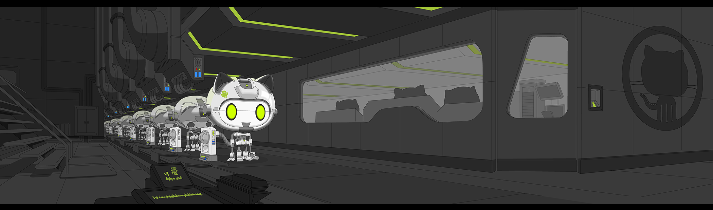

    

# Copilot Fundamentals Training Exercises

## Introduction

### :warning: Note: The primary objective of this demo Repository is not to complete all the exercises. If you don't achieve the exact results by the end, that's perfectly fine! What matters most is that you gain insight into how to use Copilot effectively.

## Overview

Our goal is to **acquaint you with Copilot's functionalities** and demonstrate diverse ways to interact effectively with Copilot.

Copilot and Copilot Chat, while built on the same backend technology, serve distinct roles within your integrated development environment (IDE). To put it simply, **Copilot functions as a coding assistant**, responding to your in-code context, while **Copilot Chat operates as your research assistant**, enabling chat-based communication for more interactive collaboration with Copilot.

As these exercises leverage Copilot for code suggestions, please note that Copilot's responses may vary depending on the context. We welcome this variability, as it showcases the dynamic capabilities of Copilot.

For effective interaction with Copilot, it's essential to keep in mind that **Copilot benefits from your guidance and supervision!**
 
 To use copilot's own words,

 
***"I’m powered by AI, so surprises and mistakes are possible. Make sure to verify any generated code or suggestions, and share feedback so that we can learn and improve."***

# Let's Build From Here...
---
### Workshop: Copilot Skills for Banking Operations

New Indonesian demo/workshop material: **business-process documents with diagrams,
architecture, PowerPoint, meeting minutes, and incident reports**. Each demo
has a single copy-ready prompt; the detailed exercises remain optional.
All banking data, issues, policies, and architecture are synthetic.

- [Open the interactive HTML workshop](demos/copilot-skills-banking/index.html)
- [Setup, facilitator guide, and downloadable starter kit](demos/copilot-skills-banking/README.md)
- [UI/UX A/B/C demo: same prompt, upstream skills, and task-specific design workflows](demos/copilot-uiux-comparison/index.html)

---
### Please follow these links to the exercises...

 
---
