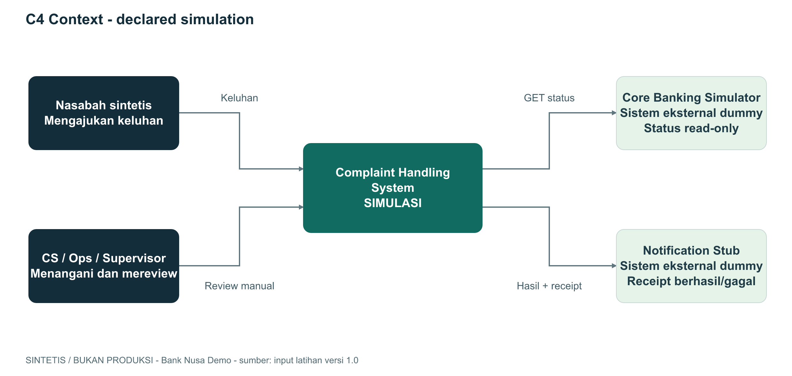
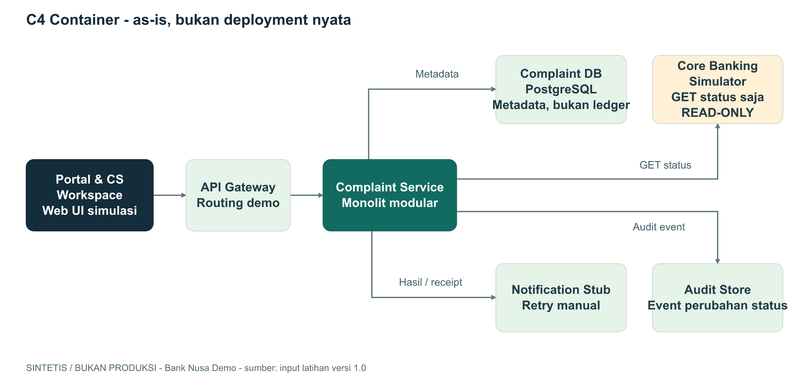
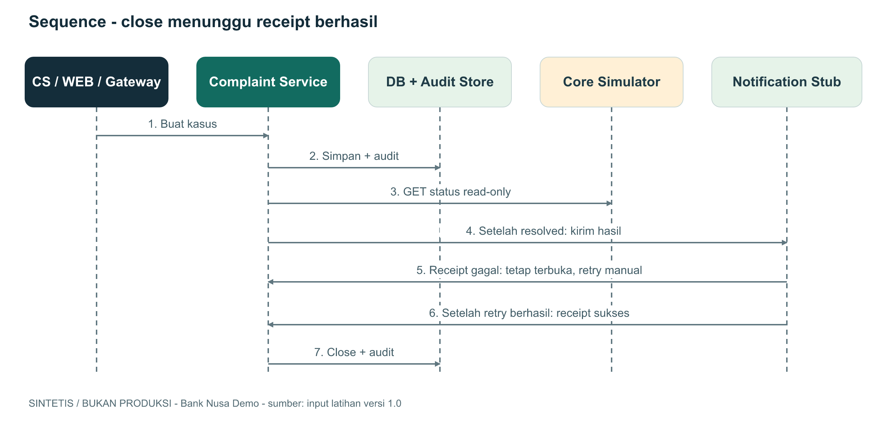

# Architecture blueprint

**SINTETIS / BUKAN PRODUKSI.** Contoh referensi ini mendokumentasikan declared
simulation, bukan hasil inspeksi source code atau deployment bank nyata.

## C4 Context - as-is

Sistem keluhan berinteraksi dengan nasabah sintetis, staf internal, simulator
status transfer, dan stub notifikasi. Database tidak ditampilkan sebagai
sistem terpisah di tingkat Context.

## C4 Container - as-is

| Komponen | Tanggung jawab | Evidence |
|---|---|---|
| Portal & CS Workspace | UI nasabah dan staf; tidak langsung ke DB | system-landscape.md |
| API Gateway | Routing demo, token simulasi | system-landscape.md |
| Complaint Service | Orkestrasi kasus, adapter, dan event | system-landscape.md |
| PostgreSQL | Metadata kasus, bukan ledger | system-landscape.md |
| Core Banking Simulator | GET status transaksi dummy, read-only | openapi.yaml |
| Notification Stub | Delivery dan receipt; retry manual | system-landscape.md |
| Audit Store | Event perubahan status, tanpa PII | system-landscape.md |

C4 Context dan Container adalah dua tingkat abstraksi, bukan dua lingkungan
deployment. Kontrol auth adalah deklarasi fixture; efektivitasnya belum diuji.

## Sequence - resolusi berbeda dari close

Urutan gagal lalu berhasil adalah skenario retry: gagal kirim membuat kasus
tetap terbuka. Receipt sukses setelah retry memungkinkan gate close jika
resolusi dan audit sudah tersedia. Pesan bukan bukti API benar-benar berjalan.

## Data dan boundary konseptual

- Browser tidak boleh mengakses database langsung.
- Akses core melalui simulator GET status; tidak ada operasi finansial.
- Metadata tidak berisi rekening, saldo, atau identitas nasabah nyata.
- Integrasi stub dan simulator tetap memerlukan review kontrak serta error path.
- Diagram tidak membuktikan IAM, segmentasi jaringan, enkripsi, atau compliance.

## To-be - USULAN, belum disetujui

1. SLA Scheduler memeriksa kasus aktif pada threshold baseline >=120 menit.
2. Transactional outbox mencatat niat notifikasi bersama perubahan data.
3. Worker mengirim ulang dengan idempotency/deduplikasi dan audit.

Manfaat potensial: pengecekan dan retry lebih konsisten. Trade-off: komponen
operasional tambahan, retry policy, duplikasi, monitoring, dan kepemilikan.
Outbox tidak menjamin exactly-once delivery. Tidak ada komitmen KPI atau biaya.
As-is tetap tidak memiliki scheduler, outbox, broker, atau retry worker.

## Unknowns dan decisions

| Topik | Status |
|---|---|
| Volume, kapasitas, ketersediaan | TBD |
| Deployment target, IAM produksi | TBD |
| Retensi audit, RTO/RPO | TBD |
| PIC individu, biaya, due date | TBD |
| ADR outbox | Proposed, perlu review |

## Evidence

Semua file sumber berada di `starter/input/`: `system-landscape.md`,
`openapi.yaml`, `business-policy.md`, `meeting-notes.md`.
Sumber diagram editable ada di folder `diagrams/`.
