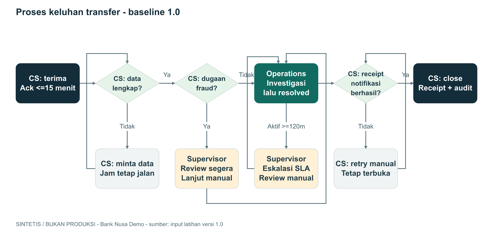

# Panduan penanganan keluhan transfer

**SINTETIS / BUKAN PRODUKSI.** Contoh referensi workshop, bukan kebijakan bank
nyata atau ketentuan regulator. Baseline 1.0; seluruh waktu WIB (UTC+07:00).

## 1. Tujuan dan batas proses

Memandu CS dan Operations menangani keluhan status transfer sintetis dari
penerimaan sampai penutupan. Tidak ada pemindahan uang, akses rekening, atau
pemblokiran otomatis. Core Banking Simulator hanya memberi status dummy.

## 2. Peran

| Peran | Tanggung jawab |
|---|---|
| CS | Terima keluhan, cek data, acknowledgement, kirim hasil, close |
| Operations | Investigasi status melalui simulator read-only |
| Supervisor | Review eskalasi SLA dan dugaan fraud |
| Nasabah sintetis | Menyampaikan keluhan dan melengkapi data dummy |

PIC individu dan due date perbaikan belum ditentukan: TBD.

## 3. Diagram proses baseline

Diagram di atas merupakan gambar tertanam. Sumber editable:
[business-process.drawio](diagrams/business-process.drawio).
Label peran pada setiap langkah membedakan CS, Operations, dan supervisor.

## 4. Langkah kerja

1. CS menerima keluhan, mencatat ID dan `received_at`.
2. Kirim acknowledgement paling lambat 15 menit. Jika data kurang, minta
   kelengkapan tanpa menghentikan atau mereset jam SLA.
3. Dugaan fraud segera dieskalasi ke supervisor untuk review manusia,
   tidak menunggu 120 menit. Tidak ada blokir otomatis.
4. Operations memeriksa status di simulator. Ketika kasus masih aktif dan
   elapsed >= 120 menit, lakukan eskalasi manual ke supervisor.
5. Setelah investigasi selesai, catat `resolved_at` dan usulkan hasil.
6. CS mengirim hasil melalui Notification Stub. Jika gagal, catat kegagalan,
   tetap terbuka, dan retry manual; jangan melakukan close.
7. Setelah receipt berhasil, catat `notified_at`. Close hanya jika resolusi,
   receipt, dan audit tersedia. Pastikan `closed_at >= notified_at`.

## 5. Baseline terukur

Sumber: `starter/input/complaints.csv`, 12 kasus biasa, lengkap, resolved.

| Metrik | Rumus / batas | Nilai |
|---|---|---|
| Ack tepat waktu | ack_at - received_at <= 15 menit | 9/12 = 75% |
| Ack terlambat | ack_at - received_at > 15 menit | 3/12 = 25% |
| Resolusi melewati 120 menit | resolved_at - received_at > 120 menit | 5/12 = 41.7% |
| Rata-rata durasi resolusi | 1280 menit / 12 kasus | 106.7 menit |

Ack terlambat: DEMO-C002, C006, C009. Resolusi >120 menit:
DEMO-C002, C004, C006, C009, C012. Tepat 120 menit adalah trigger eskalasi
untuk kasus aktif, tetapi bukan kategori metrik "resolusi >120 menit".

CSV tidak memiliki bukti event eskalasi. Tidak boleh menyimpulkan bahwa lima
kasus tersebut sudah dieskalasi atau bahwa proses manual pasti penyebabnya.

## 6. Pengecualian dan boundary review

| Skenario | Expected behavior |
|---|---|
| Ack menit 15 | Masih memenuhi SLA ack |
| Ack menit 16 | Terlambat |
| Aktif menit 119 | Belum wajib eskalasi SLA |
| Aktif menit 120 atau 121 | Wajib eskalasi ke supervisor |
| Sudah closed menit 121 | Tidak ada eskalasi untuk kasus aktif |
| Data tidak lengkap | Minta data, ack tetap berjalan |
| Dugaan fraud menit 1 | Segera review manusia |
| Notifikasi gagal | Tetap terbuka, retry manual |
| Receipt sukses, resolusi/audit belum ada | Belum boleh close |

Cabang pengecualian diuji dari kebijakan naratif; tidak direpresentasikan
dalam 12 baris CSV. Kepatuhan regulasi tidak dinilai dalam workshop ini.

## 7. Checklist penutupan

- Resolusi dan `resolved_at` tersedia.
- Receipt notifikasi berhasil dan `notified_at` tersedia.
- Audit event lengkap; tidak ada payload sensitif.
- `closed_at` tidak lebih awal dari `notified_at`.
- CS dan reviewer manusia memeriksa konsistensi dokumen.

## 8. Evidence dan status

- `starter/input/business-policy.md`: SLA, fraud, gate close.
- `starter/input/complaints.csv`: baseline kuantitatif.
- `starter/input/meeting-notes.md`: keputusan dan unknowns.
- Status: contoh draft untuk review. Tidak ada perubahan sistem yang dilakukan.
