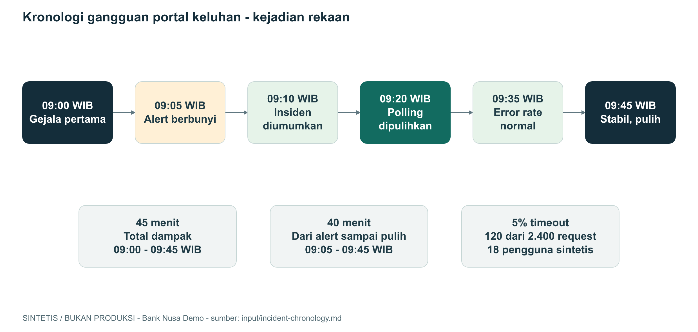

# Portal keluhan lambat - laporan setelah gangguan

**SINTETIS / BUKAN PRODUKSI.** Kejadian, bukti, dan nama adalah rekaan.
ID DEMO-INC-001; tingkat P2 khusus simulasi; status pulih.
Koordinator dan reviewer: Bima, Lead Operations (tokoh rekaan).

## Ringkasan

Setelah interval polling portal dipercepat dari 10 detik ke 1 detik, antrean
permintaan status naik dan sebagian request timeout. Dalam cerita simulasi,
interval dikembalikan pukul 09:20 WIB. Metrik kembali normal pukul 09:35,
lalu layanan dikonfirmasi stabil pukul 09:45. Bukan gangguan pemindahan uang.

## Dampak

| Hal yang diukur | Nilai dan batas pengertiannya |
|---|---|
| Seluruh jendela dampak | 09:00-09:45 WIB = 45 menit |
| Alert sampai layanan pulih | 09:05-09:45 WIB = 40 menit |
| Gejala pertama sampai terdeteksi | 5 menit |
| Request timeout dalam sampel | 120 dari 2.400 = 5% |
| Puncak error rate per menit | 20%; berbeda dari 5% untuk seluruh sampel |
| Pengguna terdampak | 18 pengguna sintetis unik, bukan 120 pengguna |
| Data hilang/korup | Tidak ditemukan pada pemeriksaan fixture ini |
| Target SLO, penalti, kerugian finansial | Tidak diberikan / TBD |

Data terpisah dari 12 keluhan pada complaints.csv. Pemeriksaan contoh ini
tidak membuktikan kontrol atau integritas sistem bank nyata.

## Diagram kronologi

Sumber editable: [incident-timeline.drawio](diagrams/incident-timeline.drawio).
Gambar dan tabel berikut merujuk kejadian yang sama.

## Urutan kejadian

| WIB / UTC | Kejadian | Bukti rekaan |
|---|---|---|
| 08:55 / 01:55 | Polling berubah dari 10 detik ke 1 detik | EVT-01 |
| 09:00 / 02:00 | Gejala timeout mulai | EVT-02 |
| 09:05 / 02:05 | Alert berbunyi, Nara mulai memeriksa | EVT-03 |
| 09:10 / 02:10 | Bima membuka koordinasi P2 simulasi | EVT-04 |
| 09:15 / 02:15 | Antrean dan pool koneksi penuh; polling menjadi dugaan awal | EVT-05 |
| 09:20 / 02:20 | Interval dikembalikan ke 10 detik dalam simulasi | EVT-06 |
| 09:35 / 02:35 | Metrik normal; belum langsung dinyatakan pulih | EVT-07 |
| 09:45 / 02:45 | Stabilitas dikonfirmasi, layanan pulih | EVT-08 |
| 09:50 / 02:50 | Komunikasi pemulihan dicatat lokal | EVT-09 |
| 10:30 / 03:30 | Review fixture mengonfirmasi penyebab dan gap proses | EVT-10 |

Tanggal untuk semua baris: 2026-10-21. WIB = UTC+07:00.

## Penyebab dan faktor yang memperberat

EVT-10 mengonfirmasi request polling berulang memenuhi antrean dan pool
koneksi. Endpoint belum membatasi polling per kasus. Gap proses: checklist
perubahan belum memeriksa interval polling, dan uji beban belum mencakup pola
polling agresif. Ini gap sistem dan proses, bukan menyalahkan individu.

Rantai pertanyaan: mengapa timeout? Antrean/koneksi penuh. Mengapa penuh?
Polling meningkat tanpa batas per kasus. Mengapa tidak terdeteksi sebelumnya?
Skenario uji dan checklist belum mencakup pola itu. Jangan menambah jawaban
lain di luar bukti cerita.

## Yang sudah berjalan baik

- Alert memberi sinyal dan on-call mulai memeriksa.
- Mitigasi dicatat, lalu stabilitas dicek sebelum menyatakan pulih.
- Bukti dan komunikasi tersimpan dalam kronologi rekaan.

## Yang perlu diperbaiki

- Batas polling per kasus dan pengujiannya.
- Skenario uji beban serta checklist perubahan konfigurasi.
- Runbook untuk melihat antrean dan koneksi aktif.

## Tindak lanjut

| Aksi | PIC rekaan | Tenggat | Selesai kalau |
|---|---|---|---|
| Desain batas polling dan uji penolakan | Ika | 2026-10-23 | Desain dan uji batas bisa direview |
| Skenario uji polling 1 detik | Sinta, QA | 2026-10-26 | Kasus uji dan hasil simulasi dicatat |
| Runbook antrean dan koneksi | Nara | 2026-10-23 | Metrik, langkah cek, dan eskalasi jelas |
| Checklist konfigurasi dan pemulihan | Bima | 2026-10-22 | Dampak polling dan bukti stabilitas tercakup |

## Sumber dan batas laporan

`starter/input/incident-chronology.md`. Label EVT hanya menunjuk baris cerita,
bukan log produksi yang diperiksa Copilot. Semua aksi adalah tugas latihan.
Tidak ada rollback, perubahan konfigurasi, issue, atau pesan nyata yang dibuat.
