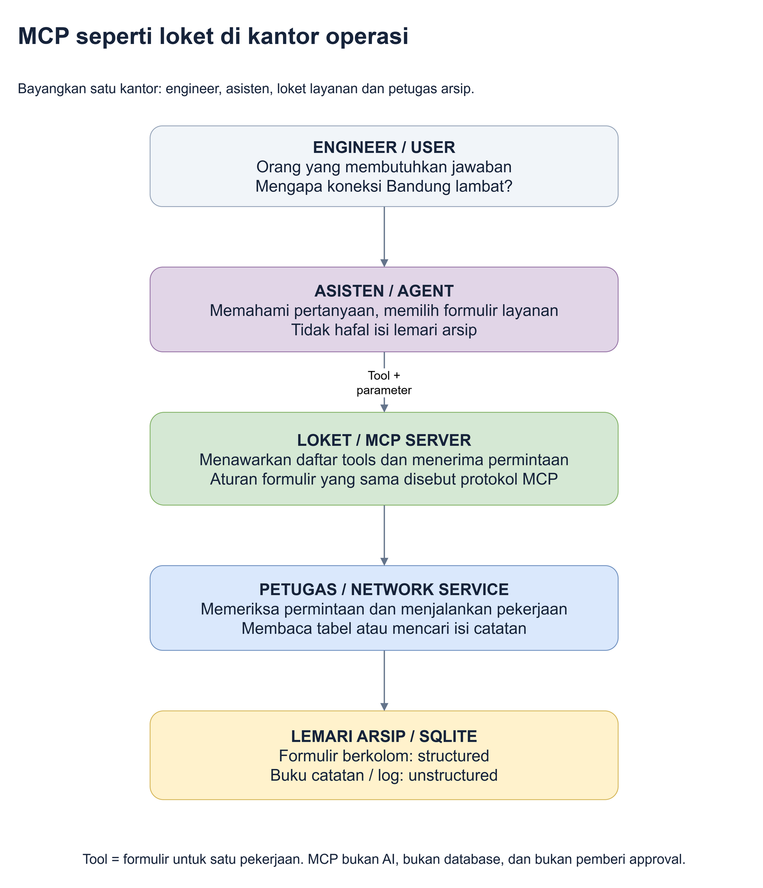

# 1. Kenalan dengan MCP dari nol

**Tujuan bab ini:** Anda bisa menjelaskan MCP dengan kata-kata sendiri, tanpa
perlu menulis kode.

## Mulai dari masalah sehari-hari

Anda adalah engineer di tim network. Seseorang melapor:

> "Koneksi kantor cabang Bandung lambat. Bisa bantu cari tahu?"

Untuk menjawabnya, Anda biasanya perlu membuka beberapa hal:

1. Daftar perangkat untuk mengetahui perangkat mana yang ada di Bandung.
2. Angka pemakaian jaringan untuk melihat bagian yang sedang padat.
3. Log, yaitu catatan kejadian yang dibuat sistem.
4. Runbook, yaitu panduan langkah pemeriksaan yang ditulis tim.
5. Catatan incident, yaitu laporan masalah dan pekerjaan yang sudah dilakukan.

**AI** adalah program yang dapat memahami permintaan dan menyusun penjelasan.
Tetapi AI tidak otomatis tahu isi aplikasi network Anda.

Kalau AI hanya ditanya tanpa diberi data atau alat untuk membacanya, jawabannya
bisa terlalu umum atau keliru. Kita ingin AI **memeriksa bukti dahulu**.

## Bayangkan satu kantor operasi

Sepanjang panduan, kita memakai dunia yang sama: **kantor operasi network**.

Anda datang ke kantor dan meminta bantuan asisten. Asisten tidak boleh asal
menjawab. Ia memakai loket layanan untuk meminta petugas mengambil arsip.
Di lemari arsip ada formulir berkolom dan buku catatan. Setelah bukti terkumpul,
asisten menjelaskan temuannya kepada Anda.

Sumber yang dapat diedit: [mcp-kantor-operasi.drawio](diagrams/mcp-kantor-operasi.drawio).

| Istilah | Arti sederhana | Dalam kantor operasi |
|---|---|---|
| **User** | Orang yang bertanya atau memberi tugas | Engineer yang datang membawa pertanyaan |
| **Model AI** | Program yang memahami bahasa dan menyusun jawaban | Kemampuan berpikir dan menjelaskan milik asisten |
| **Agent** | Program yang memakai model AI dan alat untuk menyelesaikan tugas | Asisten yang memilih layanan dan mengumpulkan bukti |
| **MCP** | Aturan baku agar aplikasi AI dapat meminta layanan dari aplikasi lain | Aturan pengisian dan pengiriman formulir di loket |
| **MCP client** | Bagian aplikasi yang mengirim permintaan sesuai aturan MCP | Pengantar formulir milik asisten |
| **MCP server** | Program yang menawarkan layanan dan menerima permintaan MCP | Loket yang memajang daftar layanan |
| **Tool** | Satu layanan yang dapat dipanggil, misalnya membaca perangkat | Formulir untuk satu jenis pekerjaan |
| **Parameter** | Nilai yang menjelaskan pekerjaan diminta untuk objek yang mana | Nama perangkat yang diisi pada formulir |
| **Service** | Kode aplikasi yang memeriksa aturan dan mengerjakan permintaan | Petugas pemeriksa sekaligus pengambil arsip |
| **Database** | Tempat menyimpan data agar dapat dibaca kembali | Lemari arsip |
| **SQLite** | Jenis database yang dipakai demo ini; tersimpan sebagai file | Lemari arsip lokal milik kantor ini |
| **Approval** | Persetujuan manusia sebelum perubahan dijalankan | Tanda tangan penanggung jawab |
| **Trace** | Catatan tool apa yang dipanggil, inputnya dan hasilnya | Buku keluar-masuk permintaan |

Tidak perlu menghafal tabel ini. Kita akan memakai istilahnya satu per satu.

## Jadi, MCP itu apa?

Nama lengkapnya **Model Context Protocol**. Dalam panduan ini, cukup ingat:

> **MCP adalah cara standar bagi agent untuk menemukan dan menggunakan layanan
> yang disediakan suatu aplikasi.**

Ada dua pekerjaan utama:

1. **Melihat daftar layanan.** Agent dapat mengetahui ada tool `get_device`
   untuk membaca satu perangkat, dan `search_documents` untuk mencari dokumen.
2. **Menggunakan layanan.** Agent dapat meminta `get_device` untuk perangkat
   `BR-SW-01`, lalu menerima data perangkat tersebut.

MCP server tidak menebak jawaban. Ia menerima permintaan, menjalankan layanan
yang sudah dibuat pengembang, dan mengembalikan hasilnya.

## Satu contoh tanpa kode

Dalam data demo, switch Bandung bernama **BR-SW-01**. Switch adalah perangkat
yang menghubungkan perangkat lain di jaringan.

| Langkah | Yang terjadi | Mengapa dibutuhkan? |
|---|---|---|
| Anda bertanya | "Mengapa Bandung lambat?" | Memberi tujuan kepada asisten |
| Agent meminta data | Memanggil tool untuk BR-SW-01 | Supaya jawabannya memakai data perangkat yang benar |
| Service membaca arsip angka | Menemukan pemakaian uplink 95% dan loss 3.2% | Mendapat bukti bahwa ada jalur yang padat |
| Agent meminta dokumen | Mencari `congestion`, lalu membaca runbook dan log | Angka saja belum menjelaskan konteks dan langkah berikutnya |
| Agent menjelaskan | Menggabungkan angka dengan catatan backup | Menjawab pertanyaan, bukan sekadar menyalin tabel |

**Uplink** adalah sambungan dari switch menuju bagian jaringan di atasnya.
**Utilisasi 95%** berarti pemakaiannya mendekati kapasitas sambungan.
**Packet loss 3.2%** berarti pada pengamatan itu ada sebagian paket data yang
tidak berhasil sampai. Paket adalah potongan data yang dikirim di jaringan.

Angka itu mendukung dugaan **congestion**, yaitu jalur jaringan yang padat.
Tetapi angka tersebut belum membuktikan siapa pengirim traffic yang menjadi
penyebab utama.

## MCP bisa membaca structured dan unstructured?

**Bisa, jika pengembang menyediakan tool dan kode aksesnya.** Bukan karena
MCP otomatis mengerti semua database atau semua format file.

- **Structured:** data berkolom, seperti nama perangkat, nama port dan nilai 95%.
- **Unstructured:** isi teks bebas, seperti runbook, log atau catatan incident.

Dalam kantor operasi, satu loket bisa menerima formulir "ambil data perangkat"
dan formulir "cari panduan". Petugas di belakang loket memakai cara kerja yang
berbeda untuk dua formulir tersebut.

Dalam aplikasi ini:

- Tool `get_device` meminta service membaca tabel dengan SQL.
- Tool `search_documents` meminta service mencari isi dokumen.
- Tool `get_document` meminta service membuka satu dokumen lengkap.

**SQL** adalah bahasa untuk meminta data dari tabel. Cara kerjanya dijelaskan
pelan-pelan di [bab tentang tools](04-mcp.md).

## Jangan tertukar

| Bayangan yang kurang tepat | Yang sebenarnya terjadi di demo |
|---|---|
| MCP adalah AI baru | AI dan MCP berbeda; agent memakai keduanya |
| MCP adalah tempat menyimpan data | Data disimpan di SQLite, bukan di "dalam protokol" |
| AI langsung bisa membuka seluruh aplikasi | Pengembang menentukan tools dan aturan yang tersedia |
| Semua database otomatis tersambung | Kode service tetap perlu dibuat untuk sumber data tersebut |
| Semua data dikirim ke model sejak awal | Data yang diperlukan dibaca melalui tool calls |
| Membaca dokumen sama dengan melatih ulang AI | Tidak; agent membaca hasil pencarian untuk percakapan saat itu |
| Bisa membaca berarti bebas mengubah | Tidak; perubahan membutuhkan jalur dan persetujuan tersendiri |

## Mana yang sungguhan, mana yang dummy?

**Dummy** berarti data contoh yang dibuat untuk latihan.

Yang sungguhan: aplikasi web, database, koneksi MCP, panggilan tool, model AI
Copilot, penyimpanan perubahan dan pencarian dokumen.

Yang dummy: seluruh perangkat, IP, kondisi jaringan, angka pengamatan, log dan
catatan. **IP** adalah alamat perangkat pada jaringan; IP di demo bukan target
perangkat yang benar-benar dihubungi.

**Snapshot** berarti potret data pada waktu tertentu. Dataset ini berakhir pada
28 Oktober 2026 pukul 14:00 WIB. Aplikasinya hidup, tetapi angka jaringan tidak
terus diperbarui dari perangkat asli.

## Cek pemahaman sebelum lanjut

Coba jawab dengan kalimat Anda sendiri:

1. Siapa yang menyusun jawaban: model AI atau MCP server?
2. Siapa yang menyimpan data: MCP atau database?
3. Mengapa agent perlu membaca angka **dan** runbook?
4. Apakah membuat change request sama dengan memperoleh approval?

Jawaban ringkas: model menyusun jawaban; database menyimpan data; angka memberi
pengamatan dan runbook memberi konteks; membuat permintaan belum berarti disetujui.

**Intinya:** asisten boleh membantu mencari arsip dan menjelaskan, tetapi bukan
pemilik semua arsip dan bukan orang yang otomatis berhak menandatangani perubahan.

Berikutnya: [Siapa melakukan apa di aplikasi ini?](02-arsitektur.md).
