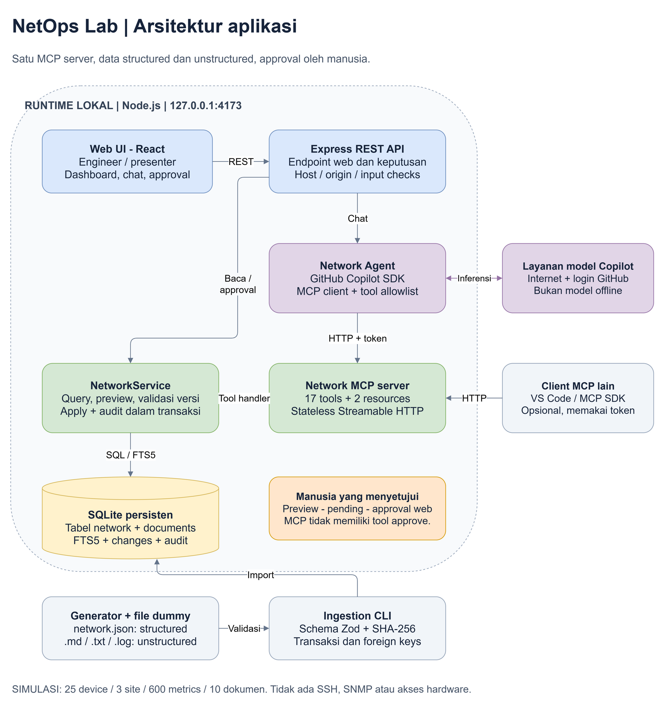
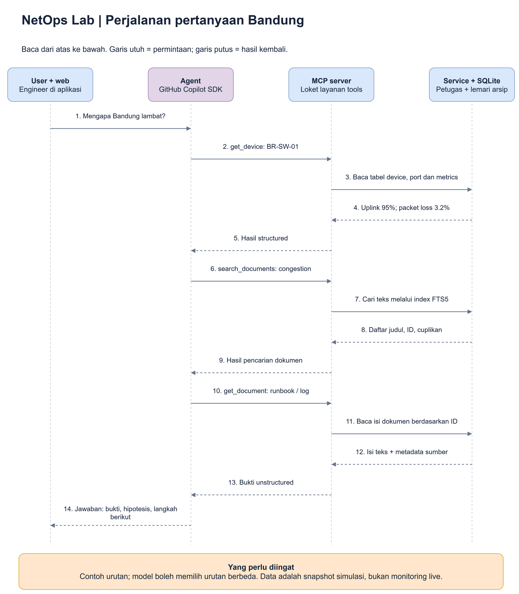

# 2. Siapa melakukan apa di aplikasi ini?

**Tujuan bab ini:** mengikuti perjalanan pertanyaan Anda dan memahami pembagian
pekerjaan. **Arsitektur** berarti susunan bagian aplikasi dan hubungan antarbagian.

Kita masih berada di kantor operasi yang sama. Pertanyaannya:

> "Mengapa koneksi Bandung lambat?"

## Lihat gambaran besarnya

Sumber yang dapat diedit: [arsitektur.drawio](diagrams/arsitektur.drawio).

Tidak perlu mengenali semua tulisan teknis di gambar sekaligus. Gunakan
terjemahan berikut.

| Tulisan pada gambar | Artinya dalam bahasa sehari-hari |
|---|---|
| Web UI / React | Layar aplikasi yang Anda buka di browser |
| Express REST API | Pintu layanan untuk tombol dan halaman web; bukan model AI |
| Network Agent / Copilot SDK | Asisten yang memakai model AI dan dapat mengirim permintaan MCP |
| Network MCP server | Loket dengan layanan seperti baca device dan cari dokumen |
| NetworkService | Petugas aplikasi yang menjalankan query dan aturan perubahan |
| SQLite | Lemari penyimpanan tabel dan teks dokumen |
| Layanan model Copilot | Tempat kemampuan AI dijalankan melalui internet |
| Ingestion CLI | Proses memasukkan data awal melalui perintah di terminal |

**API** adalah antarmuka untuk meminta pekerjaan dari program lain. **REST**
adalah pola API yang dipakai jalur web pada demo. **SDK** adalah paket kode
bantuan supaya aplikasi bisa memakai suatu layanan. **CLI** berarti antarmuka
perintah di terminal.

**React** membantu membuat layar web, **Express** membantu membuat layanan web,
dan **Node.js** menjalankan kode server. Ini alat pembangun aplikasi, bukan tiga
model AI yang berbeda. **Allowlist** pada gambar berarti daftar tool yang
diizinkan; tool di luar daftar itu tidak otomatis boleh digunakan agent.

**HTTP** adalah aturan pertukaran permintaan yang dipakai web dan koneksi MCP
demo. **Token** adalah nilai rahasia yang dipakai client sebagai bukti izin
masuk ke endpoint MCP. Endpoint berarti alamat tujuan suatu layanan program.
**Inferensi** pada gambar berarti model memproses input untuk menghasilkan hasil.

Anda tidak perlu menulis HTTP atau mengurus token untuk chat bawaan; aplikasi
menanganinya. Bagian token ada agar loket MCP tidak menerima pemanggil sembarang.

**Stateless Streamable HTTP** pada gambar adalah pilihan cara mengirim pesan MCP.
Stateless di sini berarti server tidak menyimpan sesi transport MCP antar-request.
Itu **tidak** berarti data perangkat hilang; datanya tetap tersimpan di SQLite.
**Resource** adalah informasi baca-saja yang dapat ditawarkan server, seperti
petunjuk struktur data. Berbeda dengan tool, resource bukan formulir untuk
menjalankan operasi.

## Ada dua jalur yang perlu dibedakan

### Jalur A: Anda klik dashboard

Ketika Anda membuka **Inventaris**, halaman web meminta daftar perangkat
melalui API web. Service membaca SQLite, lalu halaman menampilkan tabel.

**AI tidak perlu ikut bekerja pada langkah ini.** Karena itu inventory dan
knowledge tetap bisa dibuka walaupun agent belum login.

> **Dalam kantor operasi:** engineer boleh meminta petugas menampilkan arsip
> langsung, tanpa meminta asisten membuat analisis.

### Jalur B: Anda bertanya lewat chat

Ketika Anda bertanya "Mengapa Bandung lambat?", agent memakai model untuk
menentukan informasi yang diperlukan. Jika membutuhkan data, agent memanggil
tools MCP. Service membaca arsip, lalu hasilnya dikembalikan ke model.

**Model yang menulis jawaban akhir.** MCP server yang mengembalikan data, bukan
yang menebak kalimat jawaban.

> **Dalam kantor operasi:** asisten mengumpulkan beberapa arsip lewat loket,
> membandingkannya, lalu menjelaskan temuannya kepada engineer.

Kedua jalur melihat database yang sama. Tidak ada database rahasia terpisah
yang hanya dipakai AI.

## Kenapa dashboard dan MCP memakai service yang sama?

Supaya aturan tidak berbeda:

- Device yang dibaca UI sama dengan device yang dibaca agent.
- VLAN cross-site ditolak pada kedua jalur.
- Delete device dengan dependensi ditolak pada kedua jalur.
- Versi lama ditolak pada kedua jalur.
- Semua write melewati transaksi dan audit yang sama.

MCP tools tidak menjalankan SQL yang dibuat oleh model. Tool menerima parameter
terstruktur, lalu service menjalankan query yang sudah ditentukan dan
diparameterisasi.

## Ikuti pertanyaan Bandung sampai menjadi jawaban

Sumber yang dapat diedit: [alur-investigasi.drawio](diagrams/alur-investigasi.drawio).

Diagram ini menggabungkan user dengan layar web, serta service dengan database,
agar alurnya mudah dibaca. Diagram arsitektur di atas memperlihatkan bagian-bagian
itu secara terpisah.

| Tahap | Apa yang terjadi? | Hasil yang dipakai tahap berikutnya |
|---|---|---|
| 1. Menentukan kebutuhan | Agent melihat bahwa pertanyaan perlu angka dan penjelasan | Memilih tool pembaca perangkat dan dokumen |
| 2. Meminta angka | Tool membaca BR-SW-01 dan pengamatannya | Uplink 95%, packet loss 3.2%, error 1240 |
| 3. Mencari konteks | Tool mencari dokumen dengan kata `congestion` | Daftar judul, cuplikan dan ID dokumen |
| 4. Membaca sumber | Tool membuka runbook dan log berdasarkan ID | Panduan threshold 85% dan catatan backup |
| 5. Menyusun jawaban | Model membandingkan hasil yang diterima | Penjelasan berbasis bukti, bukan jawaban umum |

**Threshold** adalah batas yang dipakai sebagai tanda untuk melakukan
pemeriksaan. Runbook menyarankan melihat congestion jika pemakaian melewati 85%
selama beberapa sampel.

Model boleh memilih urutan atau jumlah tool calls yang berbeda. Diagram ini
contoh perjalanan yang masuk akal, bukan jawaban yang diputar dari rekaman.

## Mengapa hasil tidak langsung berarti "penyebab pasti"?

Service mengembalikan data yang ada, bukan hasil pemeriksaan fisik baru.
Model harus membedakan:

- **Observasi:** data mengatakan uplink 95% dan loss 3.2%.
- **Hipotesis:** backup mungkin berkontribusi pada kenaikan traffic.
- **Keterbatasan:** tidak ada data aliran traffic yang membuktikan pengirim
  terbesar, dan tidak ada petugas yang benar-benar mengecek kabel melalui demo.

Dalam kantor operasi, membaca laporan "ada backup" bukan sama dengan melihat
langsung seluruh sumber traffic.

## Jika user meminta perubahan, siapa yang berhak memutuskan?

Agent dapat mengusulkan perubahan dan membuat permintaan. Manusia menyetujui di
tab **Perubahan**. Service kemudian memeriksa ulang sebelum mengubah database.

Gambaran lengkapnya ada di [bab panduan aplikasi](05-panduan-aplikasi.md#latihan-perubahan-mengusulkan-bukan-langsung-mengubah).

> **Batas penting:** tidak ada tool MCP `approve_change` atau `apply_change`.
> Mengirim kalimat "saya approve" dalam chat bukan pengganti tombol approval web.

## Opsional: hubungan gambar dengan source code

Source code adalah berkas program yang menjalankan perilaku di atas. Bagian ini
untuk pembaca yang ingin membuktikan letak implementasinya, bukan prasyarat belajar.

| Komponen | File utama | Tanggung jawab |
|---|---|---|
| UI | `src/App.tsx` | Dashboard, chat, approval, feedback error |
| Kontrak | `shared/schemas.ts` | Tipe TypeScript dan validasi Zod |
| REST | `server/app.ts` | Endpoint UI, origin/host checks, error JSON |
| Agent | `server/agent.ts` | Login runtime, sesi, pemilihan tools, trace, allowlist |
| MCP | `server/mcp.ts` | Tools/resources dan transport Streamable HTTP |
| Service | `server/service.ts` | Query, search, preview, validasi, apply |
| Storage | `server/store.ts` | Schema SQLite, transaksi, FTS triggers, ingestion, audit |
| Seed | `server/seed.ts` | Dataset dan dokumen dummy deterministik |
| Import | `server/ingestion.ts` | Membaca file sumber dan validasi bundle |
| Startup | `server/index.ts` | Env, seed awal, dev/build hosting, shutdown |

## Keputusan desain

- **SQLite:** cukup untuk demo single-user, tidak membutuhkan server database.
- **FTS5:** search teks cepat tanpa embedding, vector database atau biaya tambahan.
- **Streamable HTTP stateless:** koneksi MCP mudah diuji dan tidak memerlukan
  penyimpanan sesi transport. State bisnis tetap di SQLite.
- **Copilot SDK:** model dan login memakai ekosistem GitHub Copilot yang dipilih user.
- **Satu agent:** cukup untuk demo; tidak perlu kompleksitas multi-agent.
- **Loopback:** web tanpa autentikasi produksi tidak boleh diekspos publik.

## Arah integrasi ke aplikasi network tim

Di masa depan, bagian service dapat memanggil API aplikasi network yang sudah ada.
Pertahankan kontrak tools MCP bila memungkinkan. Tambahkan autentikasi, RBAC,
identitas operator, approval organisasi, validasi vendor, observability dan rollback
sebelum mengizinkan operasi sungguhan. Diagram ini tidak mengklaim integrasi itu
sudah dibuat.

**Intinya:** model memilih dan menjelaskan, MCP mengantar permintaan dan hasil,
service mengerjakan aturan, database menyimpan bukti, dan manusia memutuskan
perubahan.

Berikutnya: [Mengenali data structured dan unstructured](03-data-dan-ingestion.md).
