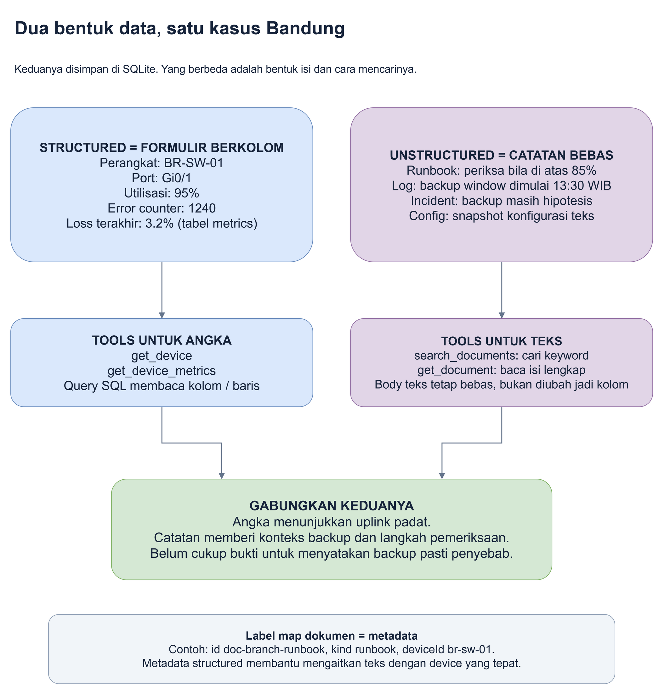
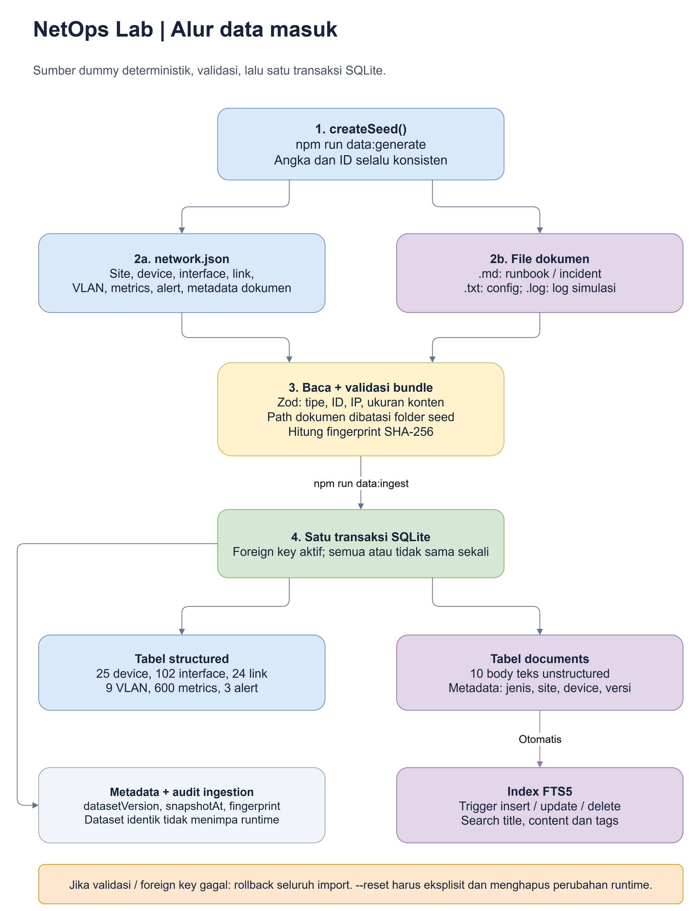

# 3. Data seperti apa yang dibaca MCP?

**Tujuan bab ini:** membedakan data berkolom dan isi teks, serta mengetahui
bagaimana keduanya sampai ke aplikasi.

Cerita kita tetap sama: **"Mengapa koneksi Bandung lambat?"**

## Dua jenis arsip di kantor yang sama

Di kantor operasi ada formulir berkolom dan buku catatan. Keduanya berguna,
tetapi menjawab pertanyaan yang berbeda.



Sumber yang dapat diedit: [jenis-data.drawio](diagrams/jenis-data.drawio).

### A. Structured: setiap nilai punya kolom

**Structured data** adalah data dengan bentuk yang sudah jelas. Bayangkan tabel:

| Perangkat | Port | Pemakaian | Error counter |
|---|---|---:|---:|
| BR-SW-01 | Gi0/1 | 95% | 1240 |

**Port perangkat** adalah titik sambungan jaringan. Nama `Gi0/1` adalah nama port
di switch, bukan nomor alamat web.

**Error counter** adalah angka penghitung error yang tercatat. Nilai 1240
menunjukkan ada error yang tercatat, tetapi tidak sendirian membuktikan kabel
rusak atau waktu setiap error terjadi.

Contoh tabel lain:

| Perangkat | Waktu sampel terakhir | Packet loss |
|---|---|---:|
| BR-SW-01 | 28 Oktober 2026, 14:00 WIB | 3.2% |

Tabel pertama berasal dari `interfaces`, yaitu daftar port. Tabel kedua berasal
dari `metrics`, yaitu angka pengamatan berdasarkan waktu.

Di aplikasi, nama kolom angka pemakaian adalah `utilizationPct`. Nama kolom
packet loss adalah `packetLossPct`. Akhiran `Pct` berarti persen.

**Mengapa bentuk berkolom berguna?** Aplikasi bisa langsung meminta "ambil
semua perangkat Bandung" atau "ambil pengamatan terakhir BR-SW-01" tanpa harus
menafsirkan satu paragraf panjang.

### B. Unstructured: isi utamanya berupa teks bebas

**Unstructured data** adalah konten yang tidak harus mengikuti kolom angka
yang sama pada setiap kalimat. Contohnya isi runbook:

> Jika utilisasi uplink di atas 85% selama beberapa sampel, periksa kemungkinan
> congestion. Cocokkan dengan packet loss dan jadwal backup.

**Backup** adalah pekerjaan membuat salinan data. Pekerjaan tersebut bisa
menggunakan kapasitas jaringan, tetapi catatan jadwal backup saja belum
membuktikan backup adalah penyebab masalah.

Contoh log:

```text
2026-10-28T07:00:00Z SIMULATION BR-SW-01 Gi0/1 utilization=95% inbound=950Mbps packet_loss=3.2% errors=1240
```

Waktu berakhiran `Z` memakai UTC, yaitu acuan waktu internasional. Pukul 07:00 UTC
sama dengan 14:00 WIB. `Mbps` adalah satuan laju data jaringan.

Log tampak memiliki beberapa pola, tetapi **demo ini menyimpan body log sebagai
teks**, bukan mengubah setiap baris log menjadi tabel event.

**Config** adalah daftar pengaturan perangkat. Dokumen config pada demo merupakan
snapshot teks pengaturan, bukan pengaturan hardware yang sedang dihubungi.
Mengubah model port di aplikasi tidak otomatis menulis ulang dokumen snapshot ini.

**Mengapa teks diperlukan?** Angka 95% mengatakan "jalur padat". Runbook
mengatakan "apa yang perlu diperiksa". Log dan catatan incident memberi konteks
"apa yang tercatat terjadi pada waktu itu".

## Dokumen tetap punya label

**Body** adalah isi utama teks dokumen. **Metadata** berarti data yang menjelaskan suatu dokumen. Bayangkan label pada
map arsip: judul, jenis dan perangkat yang dibicarakan.

Contoh map runbook kita:

| Label | Nilai | Artinya |
|---|---|---|
| `id` | `doc-branch-runbook` | Penanda unik supaya dokumen bisa diminta lagi |
| `title` | Runbook: branch lambat / uplink congestion | Judul yang terlihat pada aplikasi |
| `kind` | `runbook` | Jenis dokumen |
| `deviceId` | `br-sw-01` | Dokumen ini terkait perangkat BR-SW-01 |
| `siteId` | `site-br` | Dokumen ini terkait kantor cabang Bandung |
| `content` | Isi panduan pemeriksaan | Teks bebas yang ingin dibaca agent |

Jadi **metadata-nya structured, body-nya unstructured**. Ini tidak bertentangan.
Label map beraturan, tetapi isi catatan di dalamnya bebas.

## Apakah kedua jenis data ada di tempat berbeda?

Dalam demo ini **tidak**. Keduanya ada di file database SQLite yang sama:
`data\runtime\network.sqlite`.

Anda bisa membuka isi tabelnya tanpa melalui agent. Ikuti
[cara melihat database dan menguji pembacaan terbaru](10-bukti-data-live.md).

- Tabel `devices`, `interfaces`, `metrics` dan `alerts` menyimpan data network.
- Tabel `documents` menyimpan judul, metadata dan **isi teks**.
- Index `documents_fts` membantu mencari kata di teks.

**Tabel** adalah kumpulan baris dengan kolom yang jelas. **Index pencarian**
adalah katalog yang membantu menemukan isi dokumen tanpa membuka setiap map
satu per satu. `FTS5` adalah fitur pencarian teks SQLite yang dipakai demo.

> **Penting:** "unstructured" menjelaskan bentuk isi, bukan mewajibkan tempat
> penyimpanan tertentu. Teks bebas boleh disimpan sebagai satu kolom database.

Karena itu, tool unstructured juga dapat memakai SQL untuk mengambil teks.
Perbedaannya bukan "SQL boleh untuk structured saja", melainkan **apa yang
dicari dan bagaimana hasilnya dipakai**. Kita membedah contohnya di
[bab 4](04-mcp.md).

## Sebelum ditanya, data dummy harus disiapkan

**Ingestion** berarti memasukkan data sumber ke tempat yang akan dibaca aplikasi.
Dalam analogi kantor, ini pekerjaan menerima berkas, memeriksa label, lalu
menaruhnya di lemari dan memperbarui katalog.



Sumber yang dapat diedit: [alur-ingestion.drawio](diagrams/alur-ingestion.drawio).

Beberapa istilah kecil pada gambar:

| Istilah | Arti sederhana |
|---|---|
| Deterministik | Aturan pembuat data menghasilkan contoh yang sama saat diulang |
| Zod | Paket pemeriksa bentuk data yang dipakai kode aplikasi |
| Fingerprint / SHA-256 | Penanda digital untuk mengenali apakah paket data sama |
| Foreign key | Aturan agar ID penghubung menunjuk ke data yang benar-benar ada |
| Trigger | Pekerjaan database yang berjalan otomatis setelah data tertentu berubah |
| Rollback | Membatalkan pekerjaan dalam transaksi yang gagal |

Anda tidak perlu menghafal nama paketnya. Yang penting: berkas diperiksa
sebelum dimasukkan, dan katalog ikut diperbarui ketika dokumen berubah.

| Langkah | Apa yang dikerjakan? | Hasil yang dibuat dan siapa yang memakainya |
|---|---|---|
| 1. Membuat data contoh | Generator membuat data dan dokumen yang konsisten | File `network.json` dan dokumen; dibaca importer |
| 2. Membaca sumber | Importer membaca JSON dan isi file teks | Satu paket data; diperiksa validator |
| 3. Memeriksa bentuk | Aplikasi memeriksa ID, IP, isi dan hubungan data | Paket yang valid; boleh masuk database |
| 4. Menyimpan | Aplikasi memasukkan seluruh paket ke SQLite | Data persisten; dibaca dashboard dan MCP tools |
| 5. Membuat katalog isi | SQLite memperbarui index FTS5 | Katalog teks; dipakai `search_documents` |

**Generator** adalah kode pembuat contoh. **Importer** adalah kode pembaca sumber.
**Validator** adalah pemeriksa bentuk dan aturan data.

Jika satu bagian import gagal, aplikasi tidak ingin menyimpan separuh arsip.
Ia menggunakan **transaksi**, yaitu sekumpulan pekerjaan yang harus berhasil
bersama atau dibatalkan bersama.

Dokumen sumber berada di `data\seed\documents`. Tetapi **saat chat berlangsung,
tool membaca isi yang sudah ada di SQLite**, bukan membuka ulang file sumber
setiap kali ada pertanyaan.

## Kalau file sumber diubah, jawaban langsung berubah?

Tidak otomatis.

| Yang Anda ubah | Apa yang berubah? |
|---|---|
| File sumber di `data\seed` saja | Database belum ikut berubah; perlu proses import yang sesuai |
| Dokumen lewat aplikasi, lalu disetujui | Isi database dan hasil search berubah |
| Perangkat lewat aplikasi, lalu disetujui | Data perangkat pada database berubah |
| Hanya mengirim request pending | Target belum berubah |

**Seed** adalah paket data awal untuk mengisi demo. Proses import ulang tidak
diam-diam menimpa perubahan runtime. Runtime berarti keadaan aplikasi yang
sedang dipakai.

## Apa isi lemari arsip demo?

| Isi awal | Jumlah | Mengapa ada? |
|---|---:|---|
| Lokasi | 3 | Jakarta HQ, Serpong DC dan Bandung branch |
| Perangkat | 25 | Agar agent bisa membaca lebih dari satu perangkat |
| Interface / port | 102 | Untuk melihat kondisi per sambungan |
| Link / hubungan | 24 | Untuk melihat siapa terhubung ke siapa |
| Metrics / sampel angka | 600 | Agar ada urutan pengamatan, bukan satu angka saja |
| Dokumen | 10 | Untuk menghubungkan angka dengan pengetahuan |

**Intinya:** loket MCP yang sama dapat melayani dua permintaan berbeda karena
petugas aplikasi mempunyai cara membaca tabel **dan** cara mencari isi catatan.
MCP sendiri tidak membuat berkas, mengisi database atau melatih model.

Berikutnya: [Ikuti tool sampai ke SQL dan dokumen](04-mcp.md).
Detail kolom untuk pengembang: [referensi model data](referensi/model-data.md).
