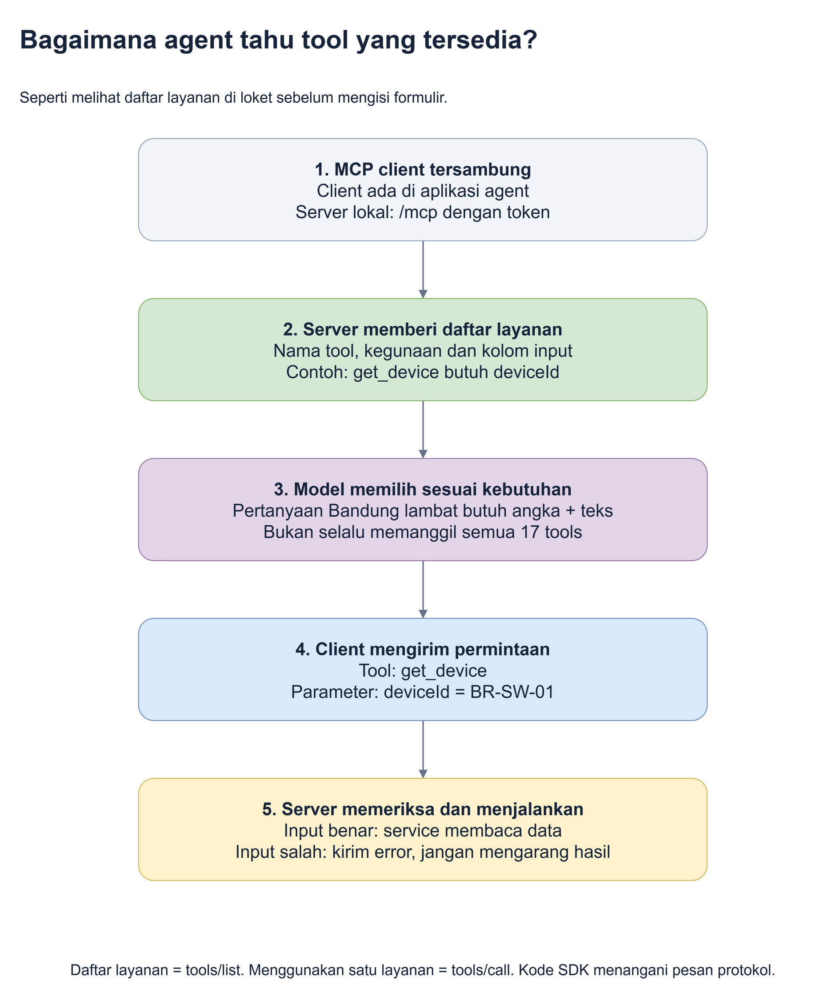
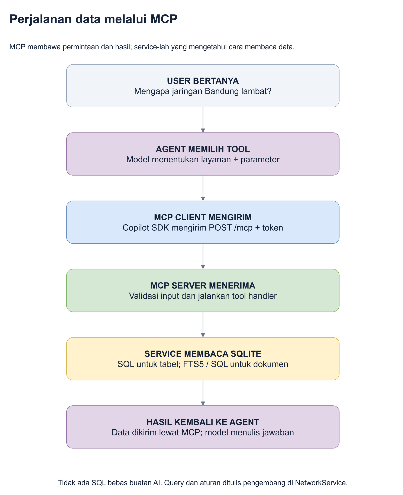
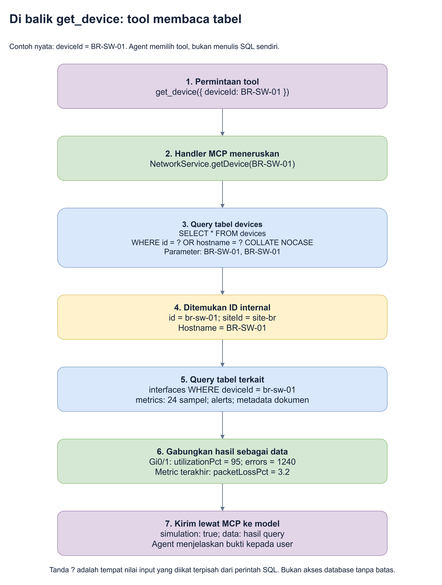
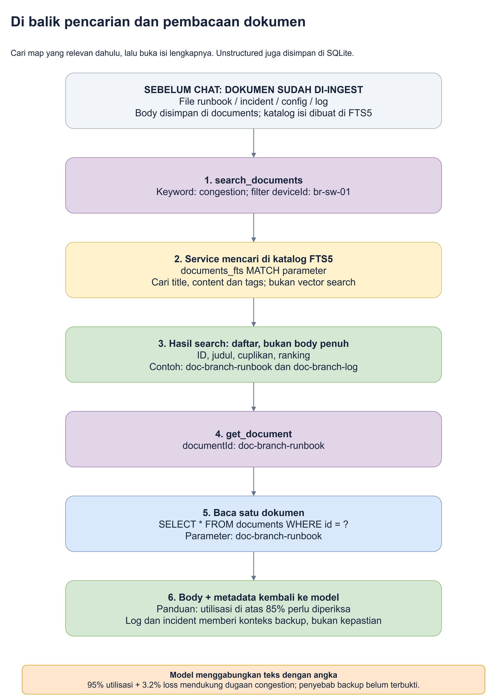

# 4. Apa yang terjadi ketika tool dipanggil?

**Tujuan bab ini:** Anda dapat mengikuti satu permintaan sampai ke data aslinya.
Kita akan melihat SQL, tetapi setiap potongan diterjemahkan ke bahasa biasa.
Anda tidak perlu menjalankannya sendiri.

Untuk melihat **file mana memanggil fungsi apa sampai ke SQL**, buka
[MCP dalam kode](11-mcp-dalam-kode.md). Panduan itu menyertakan diagram koneksi
file, diagram urutan dan tautan langsung ke handler serta implementasi 17 tools.

Jika ingin **melihat row asli dan membuktikan hasilnya berubah setelah commit**,
ikuti [panduan akses tabel dan bukti live read](10-bukti-data-live.md).
Panduan itu menyediakan inspector read-only yang terpisah dari tool MCP.

Cerita kita tetap: **"Mengapa koneksi Bandung lambat?"**

## 1. Tool bukan nama lain untuk database

**Tool** adalah satu layanan dengan pekerjaan yang jelas. Contohnya:

- `get_device`: membaca informasi satu perangkat.
- `get_device_metrics`: membaca angka pengamatan perangkat menurut waktu.
- `search_documents`: mencari dokumen berdasarkan kata.
- `get_document`: membaca satu dokumen lengkap.

**Nama tool** seperti jenis formulir layanan di kantor operasi.
**Parameter** seperti nama perangkat yang Anda tulis pada formulir itu.
**Hasil tool** seperti arsip yang dikembalikan petugas.

| Bagian permintaan | Contoh | Terjemahan |
|---|---|---|
| Tool | `get_device` | Tolong ambil detail satu perangkat |
| Parameter | `deviceId = BR-SW-01` | Perangkat yang dimaksud adalah BR-SW-01 |
| Hasil | Device, port, metrics, alert, metadata dokumen | Ini data yang ditemukan, bukan pendapat petugas |

Agent tidak sekadar menyebut nama tool di jawabannya. Ia benar-benar
mengirim permintaan dan menerima hasil sebelum membuat penjelasan.

## 2. Bagaimana agent tahu layanan apa yang ada?

Agent tidak harus menebak nama-nama layanan.



Sumber yang dapat diedit: [discovery-tools.drawio](diagrams/discovery-tools.drawio).

Saat client tersambung, MCP menyediakan cara untuk melihat daftar layanan.
Istilah teknisnya **discovery**, artinya menemukan apa yang disediakan server.

Daftar setiap tool menjelaskan:

1. **Nama:** misalnya `get_device`.
2. **Kegunaan:** membaca device beserta data terkait.
3. **Input yang diterima:** `deviceId` harus berisi nama atau ID perangkat.

Bentuk input ini disebut **schema**: aturan mengenai kolom apa yang boleh dan
harus diisi. Dalam kantor operasi, petugas tidak menerima formulir kosong atau
kolom yang tidak sesuai layanan.

Dalam kode aplikasi, pengembang mendaftarkan nama, deskripsi dan aturan input
tersebut pada MCP server. Model memakai deskripsi untuk memilih layanan yang
relevan. Itu berbeda dengan memberi AI izin bebas ke semua database.

## 3. Siapa yang mengerjakan pekerjaan setelah tool dipilih?



Sumber yang dapat diedit: [alur-akses-mcp.drawio](diagrams/alur-akses-mcp.drawio).

**Handler** adalah bagian kode yang menerima pemanggilan satu tool.
Untuk `get_device`, handler meminta `NetworkService.getDevice(...)`
menjalankan pekerjaan.

**Query** berarti permintaan kepada database. SQL adalah bahasa query yang
dipakai pada contoh ini.

Jadi ada pembagian tugas yang tegas:

| Siapa? | Melakukan apa? |
|---|---|
| Model / agent | Memilih `get_device` dan mengisi nama perangkat |
| MCP client | Mengirim pilihan itu ke MCP server |
| Handler MCP | Memeriksa input dan memanggil service yang sesuai |
| Service | Menjalankan query yang sudah ditulis pengembang |
| SQLite | Mengembalikan baris data |
| Model / agent | Menjelaskan hasil dalam bahasa manusia |

> **Jangan tertukar:** pada demo ini AI **tidak membuat SQL bebas** lalu
> menjalankannya. Pengembang yang menulis query. AI memilih tool dan nilai input.

## 4. Contoh structured: membaca BR-SW-01

**Mengapa memakai tool ini?** Kita perlu memastikan perangkat yang sedang
dibicarakan dan membaca kondisi portnya.



Sumber yang dapat diedit: [tool-structured-sql.drawio](diagrams/tool-structured-sql.drawio).

### Langkah A: agent mengisi permintaan

Bentuk berikut bernama **JSON**, yaitu format teks berisi pasangan nama dan nilai
yang mudah dibaca program:

```json
{
  "deviceId": "BR-SW-01"
}
```

Ini bukan SQL. Artinya hanya: "pakai BR-SW-01 sebagai nilai deviceId".
Nama layanan yang dipanggil adalah `get_device`.

### Langkah B: service mencari perangkat

Query yang dipakai kode:

```sql
SELECT *
FROM devices
WHERE id = ? OR hostname = ? COLLATE NOCASE
```

| Potongan | Arti sederhana |
|---|---|
| `SELECT *` | Ambil seluruh kolom dari baris yang cocok |
| `FROM devices` | Cari pada tabel daftar perangkat |
| `WHERE` | Hanya ambil baris yang memenuhi syarat |
| `id = ? OR hostname = ?` | Boleh cocok lewat ID atau nama perangkat |
| `COLLATE NOCASE` | Pencocokan hostname tidak membedakan huruf besar/kecil |

Dua tanda `?` diisi secara terpisah dengan nilai `BR-SW-01`.
Ini disebut **parameter binding**: nilainya dikirim sebagai data, bukan ditempel
menjadi potongan perintah baru.

Hasil perangkat yang ditemukan memuat:

| Kolom | Nilai |
|---|---|
| `id` | `br-sw-01` |
| `hostname` | `BR-SW-01` |
| `siteId` | `site-br` |
| `managementIp` | `10.30.0.12` |
| `status` | `warning` |

**ID** adalah penanda unik. Huruf kecil `br-sw-01` adalah ID internal;
`BR-SW-01` adalah hostname atau nama perangkat yang ditampilkan.

### Langkah C: service membaca data yang terhubung

Menemukan satu device belum cukup. Kita juga perlu membaca port dan pengamatannya.
Service memakai ID internal yang ditemukan untuk query berikut:

```sql
SELECT *
FROM interfaces
WHERE deviceId = ?
ORDER BY name
```

Tanda `?` diisi `br-sw-01`. Artinya: **ambil port milik perangkat itu saja,
lalu urutkan berdasarkan nama port**.

Untuk `Gi0/1`, hasil pentingnya:

| Nama kolom | Nilai | Makna untuk pembaca |
|---|---:|---|
| `speedMbps` | 1000 | Kapasitas port dalam Mbps |
| `utilizationPct` | 95 | Pemakaian port sudah 95% |
| `errors` | 1240 | Ada 1240 error pada counter snapshot |

Angka loss berada di tabel metrics, bukan kolom interface. Service juga membaca
metrics, alert dan metadata dokumen untuk perangkat tersebut.

**Mengapa butuh kolom penghubung `deviceId`?** Supaya pengamatan BR-SW-01
tidak tertukar dengan perangkat Jakarta atau Serpong.

### Langkah D: hasil dibungkus lalu kembali ke model

MCP mengembalikan data sebagai isi hasil tool. Bagian pentingnya memiliki label
`simulation: true`, untuk mengingatkan bahwa ini data simulasi.

Model menerima data tersebut lalu dapat menjelaskan:

> "Uplink Gi0/1 pada BR-SW-01 terpakai 95%."

Kalimat ini baru klaim tentang angka yang dibaca. Belum menjawab penyebab pasti.

## 5. Tool structured lain mengerjakan apa?

### `list_devices`: membaca daftar, bukan satu detail

Jika pertanyaannya "Perangkat apa saja di Bandung?", layanan yang cocok adalah
`list_devices` dengan `siteId = site-br`.

Untuk filter tersebut, bentuk query yang dihasilkan:

```sql
SELECT *
FROM devices
WHERE siteId = ?
ORDER BY hostname
```

Nilai `?` adalah `site-br`. Hasilnya tujuh perangkat Bandung, bukan semua
25 perangkat. Input filter lain dapat menambahkan syarat berbeda.

> **Dalam kantor operasi:** formulir "daftar perangkat Bandung" berbeda
> dengan formulir "buka map BR-SW-01", walaupun keduanya memakai lemari yang sama.

### `get_device_metrics`: membaca perubahan angka menurut waktu

Kita ingin membedakan angka sekali baca dengan urutan pengamatan.
Tool ini menerima perangkat dan jumlah sampel, paling banyak 24.

Query aktual:

```sql
SELECT *
FROM (
  SELECT *
  FROM metrics
  WHERE deviceId = ?
  ORDER BY timestamp DESC
  LIMIT ?
)
ORDER BY timestamp
```

Untuk contoh ini, parameternya `br-sw-01` dan `24`.

1. Bagian dalam mengambil sampel terbaru terlebih dahulu.
2. `LIMIT 24` membatasi jumlah baris yang dibaca.
3. Bagian luar mengurutkannya dari lama ke baru agar urutan waktu mudah dibaca.

**Timestamp** adalah penanda waktu. Sampel terakhir pada dataset ini adalah
28 Oktober 2026 pukul 14:00 WIB, dengan `packetLossPct = 3.2`.

### `network_overview`: menyusun ringkasan

Tool ini tidak membaca satu tabel bernama "jawaban". Service membaca daftar
perangkat, menghitung statusnya, menghitung jumlah data, lalu mengambil alert.
Hasil awal: 25 perangkat, 22 sehat, 2 warning dan 1 critical.

### `get_device_neighbors`: menelusuri hubungan

Service membaca device, interface dan link, lalu menghitung tetangga serta
perangkat yang mungkin berada di bawah sambungan BR-SW-01.

Ini contoh bahwa tool **tidak selalu hanya satu query SQL**. Kode service juga
bisa mengolah beberapa hasil query. Pada demo ini hasil downstream mencakup
BR-SW-02, BR-SW-03, BR-AP-01 dan BR-AP-02.

**Downstream** berarti perangkat di sisi bawah hubungan yang dimodelkan.
Hasil ini perkiraan dari peta koneksi, bukan bukti seluruh perangkat benar-benar
putus atau pengetahuan tentang rute jaringan yang berubah dinamis.

## 6. Contoh unstructured: mencari panduan yang relevan

Angka sudah ada. Agent sekarang butuh penjelasan dari runbook dan log.



Sumber yang dapat diedit: [tool-unstructured-search.drawio](diagrams/tool-unstructured-search.drawio).

### Langkah A: cari dulu, jangan buka semua dokumen

Agent memanggil `search_documents` dengan:

```json
{
  "query": "congestion",
  "deviceId": "br-sw-01"
}
```

Artinya: cari kata `congestion`, hanya pada dokumen yang terkait BR-SW-01.

**Keyword** adalah kata pencarian. **Full-text search** adalah pencarian kata
di isi teks, bukan hanya nama file. Demo memakai fitur full-text SQLite bernama
FTS5 untuk mencari pada judul, body dan tags. Tags adalah label kata kunci dokumen.

> **Dalam kantor operasi:** petugas mencari katalog isi arsip, bukan meminta
> asisten membaca seluruh lemari dari awal.

### Langkah B: service menjalankan pencarian teks

Inti syarat query-nya adalah:

```sql
WHERE documents_fts MATCH ?
  AND d.deviceId = ?
```

Ini **potongan syarat**, bukan perintah SQL lengkap yang dijalankan sendiri.
`documents_fts` adalah katalog isi yang dibuat saat ingestion.
Huruf `d` adalah nama singkat untuk tabel `documents` pada query lengkap.

- Parameter pertama adalah term FTS yang dibentuk dari keyword `congestion`.
- Parameter kedua adalah `br-sw-01`.
- `MATCH` berarti cari kata melalui katalog teks.

Service menghubungkan hasil katalog dengan tabel dokumen, mengambil cuplikan,
mengurutkan relevansinya, dan membatasi hasil maksimum 20 dokumen.

**Cuplikan** adalah sebagian isi, bukan seluruh body. **Ranking** adalah urutan
hasil berdasarkan perhitungan pencarian. Ranking bukan jaminan bahwa dokumen
teratas pasti menjawab semua pertanyaan.

Pada dataset awal, hasil relevan dapat mencakup:

| ID | Isinya tentang apa? |
|---|---|
| `doc-branch-runbook` | Panduan memeriksa branch lambat |
| `doc-branch-log` | Catatan backup window, utilisasi dan packet loss |
| `doc-branch-incident` | Catatan incident dan dugaan kontribusi backup |

Daftar ini adalah contoh dokumen relevan, bukan janji urutan ranking tertentu.

### Langkah C: buka isi lengkap dengan tool berbeda

Agent memilih `get_document`:

```json
{
  "documentId": "doc-branch-runbook"
}
```

Service menjalankan:

```sql
SELECT *
FROM documents
WHERE id = ?
```

Nilai `?` adalah `doc-branch-runbook`. Hasilnya berisi body lengkap beserta
metadata. Agent sekarang dapat membaca panduan "di atas 85%" dalam konteksnya,
bukan hanya menebak dari judul.

**Jadi benar: tool unstructured juga memakai SQL di demo ini.** SQL dipakai
untuk mengambil satu kolom teks bebas dari SQLite. Isi teks tidak mendadak
menjadi data berkolom hanya karena disimpan di database.

### Mengapa search dan read dipisah?

| Tool | Pekerjaan | Yang diterima agent |
|---|---|---|
| `list_documents` | Melihat daftar map tanpa pencarian isi | Metadata, tanpa body |
| `search_documents` | Mencari map yang relevan berdasarkan teks | Metadata, cuplikan dan ranking |
| `get_document` | Membuka satu map yang sudah dipilih | Body lengkap dan metadata |

Memisahkannya membantu agent meminta informasi secara bertahap, bukan selalu
mengirim semua dokumen ke model.

### Apakah ini vector search?

Tidak. **Vector search** adalah pendekatan pencarian berdasarkan representasi
numerik makna teks. Demo ini tidak memakainya.

Pencarian saat ini berdasarkan kata yang tertulis. Jika suatu dokumen tidak
memakai kata yang dicari, kata lain mungkin perlu dicoba.
Untuk beberapa kata, demo mencari salah satu kata yang cocok, lalu memberi
ranking. Itu sebabnya keyword pendek seperti `congestion` berguna untuk latihan.

## 7. Bagaimana angka dan teks menjadi satu jawaban?

Setelah tools selesai, model menerima bukti seperti:

| Sumber | Yang benar-benar diketahui |
|---|---|
| Tabel interface | Gi0/1 terpakai 95%; counter error 1240 |
| Tabel metrics | Packet loss terakhir 3.2% |
| Runbook | Periksa congestion jika utilisasi di atas 85% selama beberapa sampel |
| Log | Ada catatan backup window pada waktu yang terkait |
| Incident | Backup masih hipotesis, belum terkonfirmasi data aliran traffic |

Model dapat menyusun jawaban:

> "Ada indikasi congestion pada uplink BR-SW-01. Angkanya 95% dan packet loss
> 3.2%. Runbook menyarankan pemeriksaan saat pemakaian melewati 85%. Catatan
> backup memberi dugaan yang perlu diperiksa, tetapi belum membuktikan penyebab
> utamanya."

Ini **contoh jawaban yang masuk akal**, bukan template yang selalu dibalas
aplikasi. Redaksi dan pilihan urutan tools dapat berbeda.

## 8. Apakah semua tool hanya membaca?

Tidak. Ada juga tool `preview_change` untuk melihat rencana perubahan dan
`create_change_request` untuk mengajukannya.

Yang terakhir hanya menyimpan **permintaan pending**, belum mengubah target.
Agent tidak mempunyai tool untuk memberi approval.

**Pending** berarti menunggu keputusan. **Applied** berarti perubahan database
berhasil dijalankan setelah persetujuan. Penjelasan dan gambar status ada di
[panduan aplikasi](05-panduan-aplikasi.md).

### Peta seluruh 17 tools, dalam bahasa sehari-hari

Anda tidak perlu menghafal semuanya. Tabel ini membantu ketika melihat nama
layanan yang belum dikenal pada trace.

| Tool | Petugas mengerjakan apa? | Sumber / cara kerja utamanya |
|---|---|---|
| `network_overview` | Menyusun papan ringkasan | Membaca perangkat dan alert, menghitung jumlah dan status |
| `list_sites` | Melihat daftar lokasi | Query tabel sites, urut berdasarkan kode lokasi |
| `list_devices` | Membuat daftar perangkat sesuai filter | Query devices dengan syarat lokasi, status, jenis atau pencarian |
| `get_device` | Membuka map satu perangkat beserta data terkait | Query device, port, metrics, alert, site dan metadata dokumen |
| `get_device_metrics` | Membaca urutan pengamatan perangkat | Query metrics, pilih sampel terbaru, susun lama ke baru |
| `list_alerts` | Membaca pemberitahuan yang belum selesai | Query alerts yang dihubungkan ke devices; mengecualikan resolved |
| `get_topology` | Mengambil bahan peta koneksi | Membaca sites, devices, interfaces dan links |
| `get_device_neighbors` | Menghitung tetangga dan potensi downstream | Mengolah hubungan dari hasil beberapa tabel; bukan satu query saja |
| `list_vlans` | Memeriksa kelompok jaringan yang tersedia | Query vlans, dapat dibatasi satu lokasi |
| `list_documents` | Melihat label map dokumen | Query documents, mengembalikan metadata tanpa body |
| `search_documents` | Mencari kata di katalog isi | Query index FTS5 dan tabel documents untuk cuplikan/ranking |
| `get_document` | Membuka isi satu map | Query documents berdasarkan ID, kembalikan body dan metadata |
| `preview_change` | Memeriksa rencana sebelum diajukan | Membaca kondisi, memeriksa aturan/versi; tidak menulis target |
| `create_change_request` | Mencatat formulir pengajuan | Menulis request pending ke changes dan mencatat audit; target tetap |
| `list_change_requests` | Melihat antrean dan hasil keputusan | Membaca maksimum 100 request terbaru dari changes |
| `get_change_request` | Memeriksa satu pengajuan | Query changes berdasarkan ID |
| `get_audit_log` | Membaca buku kejadian | Query audit, maksimum 200 entri terbaru |

**Resolved** berarti alert sudah ditandai selesai. Daftar alert demo hanya
menampilkan yang belum selesai. **Insert** berarti menambah baris baru;
**update** berarti mengubah baris yang sudah ada. Ketika request dibuat, yang
di-insert adalah formulir pengajuan, bukan otomatis update pada perangkat.

## 9. Di mana melihat bukti pemanggilan tool?

Buka panel **Copilot** di aplikasi, kirim pertanyaan, lalu buka bagian jejak
tool pada jawaban. Perhatikan:

1. Nama tool yang dipilih.
2. Input: deviceId, query atau documentId.
3. Hasil data atau pesan error.
4. Apakah panggilan berhasil.

Trace adalah buku keluar-masuk permintaan. Jika tool gagal, kegagalan harus
terlihat. Model tidak boleh berpura-pura sudah membaca hasil yang tidak ada.

## 10. Bisa diterapkan ke aplikasi network sungguhan?

Secara konsep bisa, tetapi kode akses sumber harus dibuat.
Contohnya, petugas service yang sekarang membaca SQLite nanti dapat membaca API
aplikasi network tim. MCP tetap menawarkan layanan yang jelas di depan.

**Ini belum dikerjakan pada demo.** Sebelum akses sungguhan, organisasi perlu
menentukan izin, identitas, persetujuan, perlindungan data dan batas operasi.

**Intinya:** MCP membakukan permintaan layanan. Cara membaca tabel, mencari teks,
mengolah hasil dan memeriksa izin tetap menjadi tanggung jawab kode aplikasi.

Berikutnya: [Coba alurnya di aplikasi, klik demi klik](05-panduan-aplikasi.md).
Detail protokol opsional: [kontrak MCP](referensi/kontrak-mcp.md).
