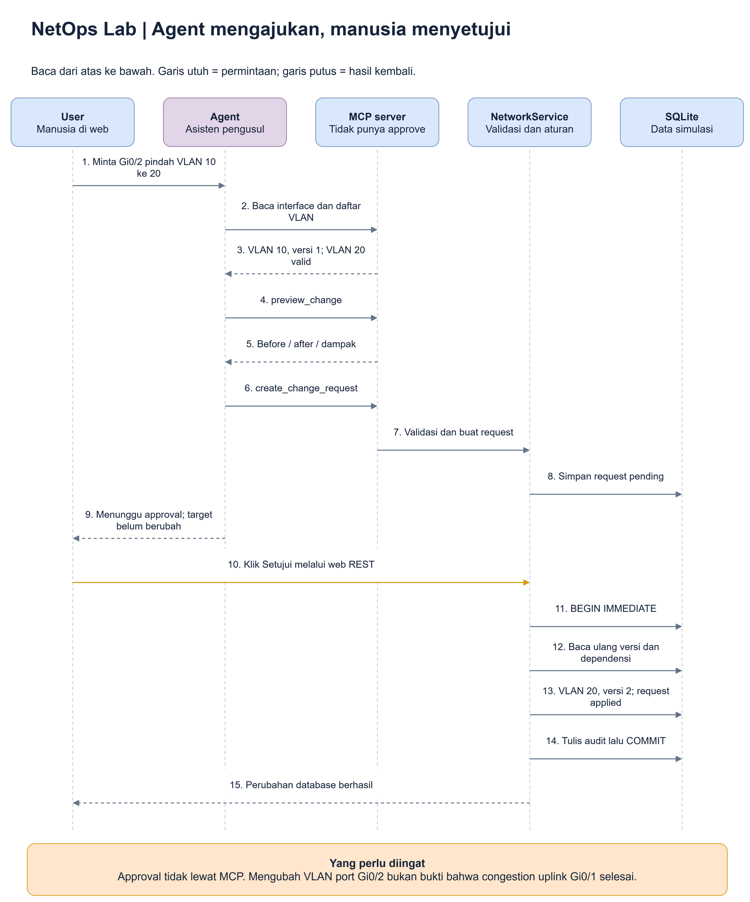

# 5. Panduan aplikasi: klik demi klik

**Tujuan bab ini:** Anda bisa menunjukkan sendiri bagaimana data dan MCP
dipakai pada NetOps Lab, bukan hanya membaca diagram.

Tidak perlu mengetik SQL. Tabel dan dokumen dibuka melalui layar aplikasi.
Angka contoh berikut berlaku pada **dataset awal**, sebelum ada perubahan demo.

## Langkah 1: buka kantor operasinya

**Di mana:** browser, buka **http://127.0.0.1:4173**.

Jika belum bisa dibuka, ikuti [panduan menyalakan demo](07-operasional.md).
Jika sudah terbuka, jangan menyalakan server kedua pada alamat yang sama.

Anda akan melihat nama **NetOps Lab**, label **SIMULATION**, dan menu:

| Menu / tombol | Untuk apa? |
|---|---|
| **Ringkasan** | Gambaran awal jumlah perangkat, lokasi dan alert |
| **Inventaris** | Daftar perangkat dan detailnya |
| **Topologi** | Peta siapa terhubung ke siapa |
| **Knowledge** | Daftar dan pencarian dokumen |
| **Copilot** | Panel chat dengan agent AI |
| **Perubahan** | Permintaan perubahan yang menunggu keputusan atau sudah diproses |
| **Audit trail** | Catatan kejadian seperti ingestion dan keputusan perubahan |
| **Panduan demo** | Ringkasan bantuan di dalam aplikasi |

**Alert** adalah pemberitahuan kondisi yang perlu diperhatikan.
**Topologi** adalah peta hubungan perangkat.
**Audit trail** adalah jejak pencatatan tindakan, bukan model AI.

> **Dalam kantor operasi:** ini ruang depan. Anda dapat melihat papan ringkasan,
> membuka lemari arsip atau meminta bantuan asisten.

## Langkah 2: baca sendiri data structured

**Mengapa:** kita ingin punya pembanding sebelum membaca jawaban AI.

**Di mana:** **Inventaris**.

1. Pada kotak pencarian, ketik `BR-SW-01`.
2. Buka detail perangkat itu dari barisnya.
3. Cari port `Gi0/1`.
4. Perhatikan pemakaian **95%** dan error counter **1240**.
5. Lihat angka pengamatan atau grafik; packet loss terakhir **3.2%**.

| Yang diperiksa | Ekspektasi data awal |
|---|---|
| Nama perangkat | BR-SW-01 |
| Lokasi | Bandung Branch |
| IP | 10.30.0.12 |
| Status perangkat | Warning |
| Port uplink | Gi0/1 |
| Pemakaian uplink | 95% |
| Error counter | 1240 |

**Hasil langkah ini:** Anda sudah melihat arsip angka yang nanti dapat dibaca
agent melalui tool. Membuka detail tidak mengubah perangkat.

Untuk melihat sumber tabelnya secara independen, bukan hanya layar web,
ikuti [panduan membuka SQLite dan membandingkan hasil SQL/MCP](10-bukti-data-live.md).

> **Dalam kantor operasi:** Anda membuka formulir pengamatan untuk mengetahui
> apa yang betul-betul tertulis, bukan menerima opini asisten begitu saja.

## Langkah 3: baca sendiri data unstructured

**Mengapa:** angka perlu konteks dan panduan penanganan.

**Di mana:** tutup detail jika menutupi navigasi, lalu buka **Knowledge**.

1. Ketik keyword `congestion`.
2. Buka **Runbook: branch lambat / uplink congestion**.
3. Cari panduan pemeriksaan pada pemakaian di atas **85%**.
4. Baca peringatan bahwa perubahan VLAN bukan obat otomatis congestion.
5. Buka **Log uplink BR-SW-01** untuk melihat catatan kejadian.

**VLAN** adalah pengelompokan jaringan secara logis. Mengganti VLAN berbeda
dengan menambah kapasitas uplink.

**Hasil langkah ini:** Anda tahu angka dan teks yang seharusnya menjadi dasar
penjelasan agent. Search dapat menemukan dokumen; membuka dokumen menampilkan
isi lengkapnya.

> **Dalam kantor operasi:** cari map lewat katalog, lalu baca catatan di dalamnya.
> Judul map saja belum cukup untuk menyimpulkan isi.

## Langkah 4: hubungkan asisten AI

**Di mana:** klik **Copilot**, lalu **Hubungkan Copilot**.

Agent memakai login GitHub Copilot pada komputer. **Login** adalah proses
membuktikan akun Anda kepada layanan. Jika belum login, lihat
[langkah login](07-operasional.md#langkah-4-login-dan-hubungkan-agent).

Tunggu sampai status menyatakan Copilot terhubung. Jangan memasukkan token
GitHub atau password ke kotak chat.

**Hasil langkah ini:** runtime agent siap menghubungi model. Ini belum berarti
ada perubahan data atau semua dokumen sudah dibaca.

> **Dalam kantor operasi:** asisten sudah siap bekerja. Menyiapkan asisten
> bukan sama dengan memberinya tanda tangan persetujuan perubahan.

## Langkah 5: minta investigasi, lalu periksa jejaknya

Kirim:

> Mengapa koneksi branch Bandung lambat? Gabungkan data perangkat BR-SW-01,
> metrics, log, runbook, dan catatan incident. Bedakan bukti dan hipotesis.
> Jangan membuat perubahan.

Tunggu jawaban. Agent mungkin membutuhkan beberapa pemanggilan tool.
Kemudian buka detail **jejak tool** pada percakapan.

**Metrics** berarti angka pengamatan perangkat menurut waktu.
**Hipotesis** berarti dugaan yang masih perlu dibuktikan.

| Pada jejak tool | Yang ingin Anda lihat |
|---|---|
| Nama layanan | Misalnya `get_device`, `search_documents`, `get_document` |
| Input | Nama BR-SW-01, keyword congestion, atau ID dokumen |
| Hasil | Angka perangkat, hasil search, atau isi runbook/log |
| Status | Berhasil atau error; bukan cuma kalimat "sedang memeriksa" |

Jawaban yang baik menghubungkan uplink 95%, loss 3.2% dan panduan 85%, lalu
menyatakan bahwa backup masih dugaan yang perlu bukti tambahan.

**Hasil langkah ini:** pertanyaan bahasa manusia benar-benar menyebabkan
aplikasi mengambil data dan menyusun jawaban.

> **Dalam kantor operasi:** lihat buku keluar-masuk permintaan agar Anda tahu
> arsip mana yang diambil asisten dan apakah pengambilannya berhasil.

## Latihan perubahan: mengusulkan, bukan langsung mengubah

Latihan ini hanya untuk menunjukkan kontrol persetujuan. **Ini bukan solusi
untuk congestion pada Gi0/1.** Kita memakai port lain, **Gi0/2**.

### A. Minta usulan

Kirim:

> Baca kondisi terbaru BR-SW-01 Gi0/2. Buat satu change request untuk
> memindahkannya dari VLAN 10 ke VLAN 20, dengan alasan demonstrasi
> pemindahan port ke Operations. Tampilkan preview dan jangan apply.

**Change request** berarti permintaan perubahan. **Preview** berarti gambaran
kondisi sebelum dan sesudah. **Apply** berarti menjalankan perubahan.

Sumber yang dapat diedit: [alur-perubahan.drawio](diagrams/alur-perubahan.drawio).

**BEGIN** dan **COMMIT** pada gambar adalah penanda awal dan akhir transaksi
database. Artinya pekerjaan perubahan diproses sebagai satu paket: jika gagal,
aplikasi tidak ingin meninggalkan perubahan separuh jalan.

### B. Buktikan bahwa request belum mengubah target

1. Buka **Perubahan**.
2. Lihat request baru dengan status **pending**.
3. Periksa preview: VLAN 10 direncanakan menjadi VLAN 20.
4. Buka kembali detail port. Sebelum approval, VLAN masih **10**.

**Hasilnya:** yang disimpan baru permintaan, bukan perubahan target.

> **Dalam kantor operasi:** formulir sudah diajukan tetapi belum ditandatangani.
> Petugas belum boleh mengganti arsip target.

### C. Manusia menyetujui dari layar web

1. Kembali ke **Perubahan** dan buka request.
2. Baca alasan, before/after dan dampaknya.
3. Klik tindakan **Setujui**, lalu konfirmasikan pada dialog keputusan.
4. Baca ulang port dan status request.

Jika tidak ada perubahan lain yang bentrok:

| Bagian | Sebelum approval | Sesudah approval |
|---|---|---|
| VLAN Gi0/2 | 10 | 20 |
| Versi interface | 1 | 2 |
| Status request | Pending | Applied |
| Audit | Request tercatat | Keputusan dan apply ikut tercatat |

**Versi** adalah angka penanda revisi data. Angka ini membantu aplikasi
menolak permintaan lama yang mencoba menimpa data baru.

Jangan salah membaca hasilnya: **database simulasi berhasil diubah**.
Tidak ada command yang dikirim ke switch sungguhan.

## Mengapa ada pending, rejected, applied dan failed?

Sumber yang dapat diedit: [status-perubahan.drawio](diagrams/status-perubahan.drawio).

| Status | Arti sederhana | Analogi kantor operasi |
|---|---|---|
| Pending | Menunggu keputusan | Formulir belum ditandatangani |
| Rejected | Manusia menolak | Penanggung jawab tidak menyetujui formulir |
| Applied | Disetujui dan berhasil dijalankan | Petugas mengganti arsip sesuai persetujuan |
| Failed | Pemeriksaan saat approval gagal | Formulir tidak bisa dijalankan, misalnya nomor revisinya sudah lama |

Contoh konflik: dua request dibuat saat port masih versi 1. Request pertama
berhasil dan membuat versi 2. Request kedua tidak boleh diam-diam menimpa
versi 2; aplikasi meminta pembacaan dan pengajuan baru.

## Apa yang tidak otomatis berubah?

Setelah VLAN Gi0/2 diubah:

- Alert congestion pada uplink Gi0/1 tidak otomatis hilang.
- Metrics historis tidak ditulis ulang.
- Dokumen konfigurasi teks tetap snapshot historis.
- Tidak ada jaminan masalah jaringan selesai.

Dalam kantor operasi, mengganti satu formulir konfigurasi bukan berarti semua
laporan pengamatan lama tiba-tiba ikut berubah.

## Reset hanya jika ingin mengulang latihan

**Reset demo** mengembalikan dataset awal. Ini menghapus perubahan, request dan
audit lama; kemudian mencatat reset baru.

Gunakan tombol reset dan konfirmasi eksplisit **hanya jika Anda memang ingin
menghapus latihan saat ini**. Tunggu jawaban agent selesai sebelum reset.

**Intinya:** membaca data aman dari perubahan target; mengajukan perubahan
belum berarti menerapkannya; approval tetap pekerjaan manusia.

Berikutnya: [Latihan dan cara menilai jawaban](06-skenario-demo.md).
Contoh CRUD tambahan: [referensi operasi](referensi/operasi-crud.md).
