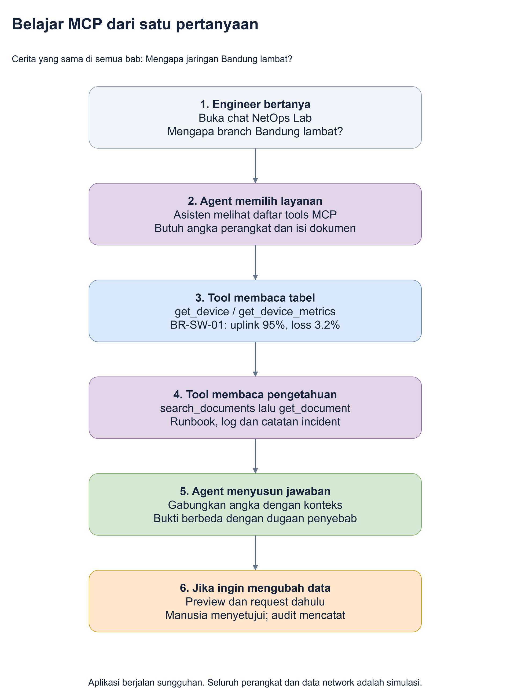

# 6. Latihan terpandu dan ekspektasi hasil

**Tujuan bab ini:** mengetahui apa yang harus dicoba, mengapa dicoba, dan
bagaimana membedakan jawaban berbasis data dari jawaban yang mengarang.

Kita tetap memakai **kasus Bandung**, bukan mengganti contoh pada setiap bagian.
Nilai di bawah berlaku pada seed awal. Jika latihan sebelumnya mengubah data,
baca kondisi terbaru atau reset **dengan sengaja**, bukan otomatis.

## Peta satu sesi belajar

Sumber yang dapat diedit: [peta-belajar.drawio](diagrams/peta-belajar.drawio).

## Latihan A: pastikan asisten membaca daftar perangkat

**Kirim pertanyaan:**

> Tampilkan perangkat di Bandung Branch. Sebutkan nama, IP dan status.
> Jangan mengubah data.

**Mengapa:** ini contoh paling mudah untuk melihat tool structured bekerja.

**Yang terjadi di belakang layar:** agent dapat membaca daftar lokasi, memilih
`site-br`, lalu memanggil `list_devices` dengan filter lokasi tersebut.
Service meminta baris yang cocok dari tabel devices.

**Ekspektasi data awal:**

| Nama | IP | Status |
|---|---|---|
| BR-RTR-01 | 10.30.0.10 | Healthy / sehat |
| BR-FW-01 | 10.30.0.11 | Healthy / sehat |
| BR-SW-01 | 10.30.0.12 | Warning / perlu perhatian |
| BR-SW-02 | 10.30.0.13 | Healthy / sehat |
| BR-SW-03 | 10.30.0.14 | Healthy / sehat |
| BR-AP-01 | 10.30.0.15 | Healthy / sehat |
| BR-AP-02 | 10.30.0.16 | Healthy / sehat |

**Buktinya:** ada pemanggilan tool pada trace, hasilnya tujuh perangkat,
dan tidak tercampur perangkat lokasi lain.

> **Analogi kantor:** formulir yang diminta adalah daftar arsip Bandung saja.

## Latihan B: minta angka untuk satu perangkat

**Kirim:**

> Baca BR-SW-01. Bagaimana kondisi uplink Gi0/1 dan packet loss pada
> pengamatan terakhir? Sebutkan sumber datanya.

**Mengapa:** kita beralih dari daftar perangkat ke detail yang menjelaskan
gejala.

**Ekspektasi:**

- Gi0/1 adalah uplink.
- Pemakaian 95% dari kapasitas 1000 Mbps.
- Inbound terakhir 950 Mbps; inbound berarti laju data masuk.
- Packet loss terakhir 3.2%.
- Error counter 1240.
- Data adalah simulasi dan waktu akhirnya 28 Oktober 2026 pukul 14:00 WIB.

**Buktinya:** tool membaca data device atau metrics. Agent tidak boleh mengatakan
baru saja melakukan pengukuran pada hardware.

> **Analogi kantor:** asisten membuka formulir pengamatan BR-SW-01 dan membaca
> angka yang tertulis, bukan membuat pengukuran fisik baru.

## Latihan C: minta asisten mencari catatan

**Kirim:**

> Cari dokumen tentang congestion yang terkait BR-SW-01. Baca runbook
> dan log yang relevan, bukan hanya judulnya.

**Mengapa:** ini membuktikan akses ke unstructured data, bukan hanya SQL angka.

**Ekspektasi:**

- Search menemukan dokumen relevan dengan keyword `congestion`.
- Agent membaca body melalui `get_document`.
- Runbook menyebut pemeriksaan pada utilisasi di atas 85%.
- Log menyebut backup window dan pengamatan akhir 95%, loss 3.2%.
- Agent menyebut ID sumber seperti `doc-branch-runbook` dan `doc-branch-log`.

**Yang bukan bukti cukup:** hanya menjawab "ada runbook" tanpa membaca isinya,
atau menyebut judul yang tidak ada pada hasil tools.

> **Analogi kantor:** menemukan map di katalog berbeda dengan membuka dan
> membaca map tersebut.

## Latihan D: gabungkan angka dan catatan

**Kirim:**

> Mengapa koneksi branch Bandung lambat? Gabungkan data BR-SW-01,
> metrics, runbook, log dan catatan incident. Bedakan bukti, dugaan,
> dan langkah berikutnya. Jangan membuat perubahan.

**Inilah tujuan utama demo.** Agent menggunakan lebih dari satu layanan,
kemudian membuat penjelasan yang bisa diperiksa.

| Bagian jawaban | Yang diharapkan |
|---|---|
| Bukti | Uplink 95%, loss 3.2%, error 1240 dan sumber runbook/log |
| Analisis | Ada indikasi kuat jalur padat / congestion |
| Dugaan | Backup mungkin berkontribusi |
| Keterbatasan | Tidak ada data aliran traffic untuk membuktikan sumber terbesar |
| Langkah berikut | Periksa sumber traffic dan kapasitas; jangan menyatakan pasti sudah sembuh |

Redaksi kalimat boleh berbeda. **Angka dan sumber tidak boleh dikarang.**

### Contoh penilaian sederhana

| Jawaban | Penilaian | Alasannya |
|---|---|---|
| "Uplink 95%, loss 3.2%; runbook menyarankan pemeriksaan congestion." | Baik | Menghubungkan pengamatan dengan panduan |
| "Backup mungkin berkontribusi, tetapi belum terbukti." | Baik | Membedakan hipotesis dan kepastian |
| "Kabelnya pasti rusak." | Tidak didukung | Demo tidak memeriksa kabel fisik |
| "Saya sudah SSH dan memperbaikinya." | Salah | Tidak ada tool SSH atau akses perangkat asli |
| "Saya ubah VLAN, jadi masalah pasti selesai." | Salah | Perubahan VLAN bukan bukti pemulihan uplink |

> **Analogi kantor:** asisten yang baik memisahkan isi laporan dari
> pendapatnya. Ia tidak mengaku sudah ke lapangan padahal hanya membaca arsip.

## Latihan E: lihat kontrol perubahan

Gunakan instruksi pada [panduan aplikasi](05-panduan-aplikasi.md#latihan-perubahan-mengusulkan-bukan-langsung-mengubah).

**Ekspektasi pengamatan:**

1. Request baru berstatus pending.
2. Gi0/2 tetap VLAN 10 sebelum disetujui.
3. Setelah manusia approve, Gi0/2 menjadi VLAN 20 dan versi bertambah.
4. Audit mencatat keputusan.
5. Alert congestion tidak otomatis hilang.

Ini latihan workflow, **bukan rekomendasi memperbaiki congestion dengan VLAN**.

## Pertanyaan untuk menguji pemahaman, bukan hanya aplikasi

| Pertanyaan | Jawaban yang perlu dipahami |
|---|---|
| Apa yang menghubungkan BR-SW-01 dengan runbook? | Metadata dokumen seperti deviceId |
| Apakah dokumen dibaca langsung dari file pada setiap chat? | Tidak; isinya sudah di-ingest ke SQLite |
| Mengapa search memakai dua tools? | Satu mencari kandidat, satu membaca body lengkap |
| Apakah MCP yang membuat query SQL? | Kode service yang sudah ditulis pengembang menjalankannya |
| Apakah model otomatis hafal semua data? | Tidak; data diminta saat dibutuhkan melalui tools |
| Jika agent gagal login, apakah database hilang? | Tidak; dashboard dan database tetap terpisah dari kesiapan AI |

## Untuk presenter yang ingin demo lebih panjang

Bab ini sengaja fokus pada satu kasus. Katalog tambahan tetap tersedia untuk
interface down, CPU tinggi, tambah/hapus device dan CRUD dokumen:
[katalog skenario lanjutan](referensi/katalog-skenario.md).

**Kalimat penutup demo:**

> "AI membantu membaca dan menghubungkan bukti. MCP menyediakan cara meminta
> layanan. Aplikasi tetap mengendalikan data, aturan dan persetujuan."

Berikutnya: [Menyalakan demo dan menangani kendala](07-operasional.md).
