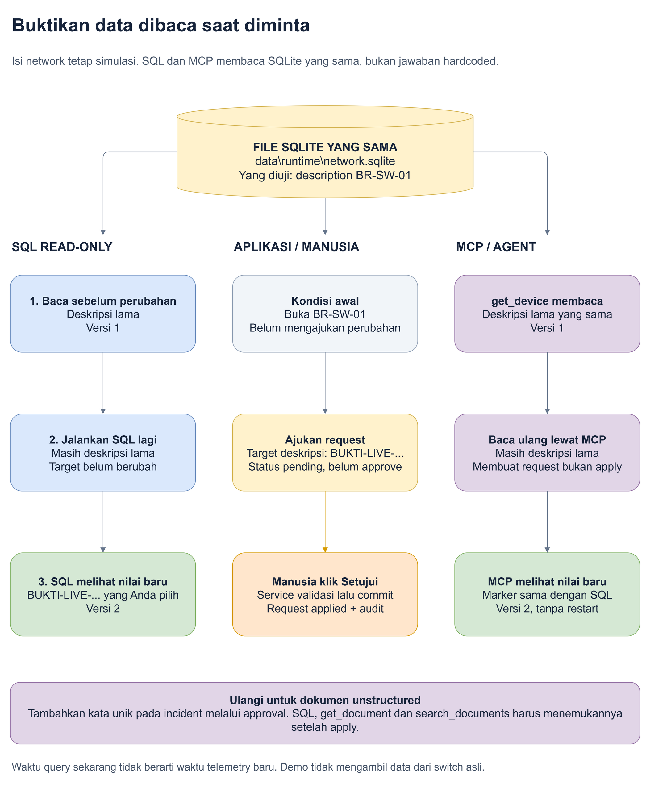

# 10. Lihat tabelnya sendiri: buktikan SQL membaca data terbaru

**Tujuan:** Anda tidak harus percaya pada kalimat "AI sudah membaca database".
Anda dapat membuka data secara terpisah, membandingkan hasil, lalu melihat
perubahan yang baru Anda buat muncul melalui SQL dan MCP.

## 1. Luruskan arti "live" dahulu

| Yang ditanyakan | Jawaban yang jujur pada demo ini |
|---|---|
| Apakah perangkat dan angka network adalah data contoh? | Ya, isinya simulasi |
| Apakah SQLite benar-benar menyimpan tabel dan row? | Ya |
| Apakah query benar-benar dijalankan ketika diminta? | Ya, membaca isi database saat pembacaan berlangsung |
| Apakah hasil tool hanya kalimat statis yang ditentukan sebelumnya? | Tidak; tool membaca dan mengolah data dari database |
| Apakah aplikasi sedang polling switch asli? | Tidak |

**Live read** di bab ini berarti membaca isi database yang sudah tersimpan
saat permintaan dijalankan. Bukan mendapatkan pengukuran hardware baru.

**Hardcoded** berarti nilai hasil ditulis tetap dalam program, misalnya
selalu membalas deskripsi yang sama tanpa membaca tabel.

> **Dalam kantor operasi:** arsipnya memang arsip latihan, tetapi petugas
> benar-benar mengambil arsip yang sekarang tersimpan. Ia tidak mengulang
> jawaban dari hafalan.

## 2. File database yang mana?

Lokasi default:

```text
C:\clients\Organization\demo\fundamental\network-mcp-demo\data\runtime\network.sqlite
```

Inilah file runtime yang dipakai aplikasi. **Jangan membuka `network.json` lalu
menganggapnya database live.** JSON pada folder seed adalah bahan awal, bukan
sumber pembacaan tool setelah ingestion.

Jika `DATABASE_PATH` diubah pada konfigurasi, lokasinya dapat berbeda.
Perintah inspeksi di bawah membaca konfigurasi yang sama dan menampilkan
**path yang benar-benar dilaporkan oleh koneksi SQLite**.

Jika konfigurasi diubah ketika server masih berjalan, restart server yang
Anda kelola atau pastikan proses server dan inspector memakai path yang sama.
File dengan nama sama pada folder lain tetap merupakan database yang berbeda.

## 3. Cara paling mudah: lihat daftar tabel di terminal

**Mengapa:** Anda perlu tahu tabel apa yang ada sebelum memilih data.

**Di mana:** VS Code, buka folder aplikasi, pilih **Terminal > New Terminal**.

```powershell
Set-Location 'C:\clients\Organization\demo\fundamental\network-mcp-demo'
npm run db:inspect
```

Perintah ini:

1. Membuka file database yang **sudah ada**, dalam mode **read-only**.
2. Menampilkan lokasi file dan waktu pembacaan sekarang.
3. Menjalankan query count untuk tabel yang diizinkan.
4. Menampilkan daftar tabel dan jumlah row.

**Row** berarti satu baris data. **Read-only** berarti hanya membaca; inspector
tidak mempunyai perintah untuk menambah, mengubah atau menghapus.

Jika file belum ada, perintah memberikan error dan tidak membuat database kosong
seolah-olah berhasil. Siapkan data dengan `npm run seed` atau jalankan aplikasi.

| Tabel | Yang dapat Anda lihat |
|---|---|
| `devices` | Nama, IP, deskripsi dan versi perangkat |
| `interfaces` | Port, VLAN, pemakaian dan versi |
| `metrics` | Angka pengamatan beserta timestamp |
| `documents` | Metadata **dan body teks** |
| `changes` | Request pending/applied/rejected/failed |
| `audit` | Catatan pengajuan dan keputusan |
| `documents_fts` | Index pencarian teks; bukan pengganti tabel documents |

**Hasil yang dibuat dan dipakai:** terminal menampilkan hasil SQL sekarang;
Anda memakainya sebagai pembanding terhadap layar dan tool MCP.

> **Analogi kantor:** Anda memeriksa daftar isi lemari secara langsung.

## 4. Buka baris perangkat Bandung

```powershell
npm run db:inspect -- --table devices --device-id br-sw-01
```

`--` memisahkan opsi npm dari opsi perintah inspeksi.
`--table` memilih tabel. `--device-id` memilih **ID internal** huruf kecil,
yaitu `br-sw-01`, bukan hostname `BR-SW-01`.

Anda akan melihat:

- File SQLite yang dibuka.
- Waktu query, yang berbeda dengan waktu pengamatan network.
- SQL yang benar-benar dijalankan.
- Parameter yang diikat ke SQL.
- Row hasil query.

Contoh query inspector:

```sql
SELECT *
FROM devices
WHERE id = ?
ORDER BY id
LIMIT ?
```

Parameternya `br-sw-01` dan batas row, default 25.
Angka batas bukan jumlah row yang harus ada; filter perangkat ini biasanya
menemukan satu baris.

**Inspector dan tool MCP adalah dua pembaca berbeda.** Inspector memakai query
read-only sendiri. Tool `get_device` memakai query service yang juga membaca
data terkait. Kita membandingkan nilai field dari file yang sama, bukan mengklaim
semua SQL kedua jalur identik.

## 5. Buka port, metrics dan body dokumen

```powershell
# Port pada perangkat Bandung.
npm run db:inspect -- --table interfaces --device-id br-sw-01

# Tiga pengamatan terbaru, urut dari yang terbaru.
npm run db:inspect -- --table metrics --device-id br-sw-01 --limit 3

# Dokumen yang terkait perangkat tersebut.
npm run db:inspect -- --table documents --device-id br-sw-01

# Body lengkap dalam format JSON; tampilan tabel memotong teks panjang.
npm run --silent db:inspect -- --table documents --device-id br-sw-01 --json

# Request dan audit terbaru.
npm run db:inspect -- --table changes --limit 5
npm run db:inspect -- --table audit --limit 5
```

Batas pembacaan adalah 1 sampai 100 row, default 25. Jika hasil dibatasi, jangan
menyimpulkan row lain tidak ada. Daftar jumlah row pada awal output adalah jumlah
seluruh tabel; preview berikutnya mengikuti filter dan limit.

`--silent` pada npm menghilangkan banner perintah, sehingga output `--json`
berupa JSON yang bisa disimpan atau dibaca program lain.

Waktu berakhiran `Z` pada output menggunakan UTC. Untuk WIB, tambahkan tujuh jam.
Bandingkan kedua waktu dalam zona yang sama.

**Waktu query sekarang bukan timestamp telemetry.** Contoh: Anda membaca pukul
23:30, tetapi sampel terakhir masih 14:00 WIB. SQL mengambil row terbaru yang
tersimpan; demo tidak membuat pengukuran baru dari perangkat.

## 6. Pembuktian terkuat: ubah satu nilai yang Anda pilih sendiri

Sekali melihat angka 95% belum membuktikan hasilnya tidak hardcoded. Karena itu
kita memakai **deskripsi perangkat** dan marker yang Anda pilih saat demo.

**Marker** adalah teks penanda unik. Pilih sendiri, misalnya
`BUKTI-LIVE-BANDUNG-2330`, atau buat kata lain yang belum ada.
Contoh ini hanya teks latihan, bukan nilai yang harus selalu digunakan.



Sumber yang dapat diedit: [bukti-data-live.drawio](diagrams/bukti-data-live.drawio).

### A. Baca nilai sebelum perubahan

1. Jalankan inspector perangkat pada langkah 4.
2. Catat `description` dan `version`.
3. Buka **Inventaris**, cari BR-SW-01 dan buka detail.
4. Minta agent:

   > Panggil get_device untuk BR-SW-01 sekarang. Sebutkan description dan
   > version persis dari hasil tool. Jangan menjawab dari percakapan sebelumnya.

Ketiga pembaca harus menunjukkan nilai yang sama. Pada seed awal versi adalah
1; jika Anda sudah mengubahnya, gunakan versi sekarang.

> **Analogi kantor:** Anda dan asisten membuka salinan data dari lemari yang sama.

### B. Ajukan perubahan melalui aplikasi

1. Pada detail BR-SW-01, pilih **Ubah atribut**.
2. Isi deskripsi dengan marker pilihan Anda.
3. Isi alasan, misalnya `Pembuktian SQL membaca nilai database terbaru`.
4. Lihat preview lalu ajukan request.
5. **Jangan approve dahulu.**
6. Jalankan ulang inspector.

**Ekspektasi:** description masih nilai lama. Marker baru hanya berada pada
formulir permintaan, bukan row target perangkat.

Ini menunjukkan aplikasi membedakan menyimpan request dengan menjalankan update.

### C. Manusia approve, lalu baca ulang tanpa restart

1. Buka tab **Perubahan**.
2. Pilih request tadi, baca preview, lalu **Setujui** dan konfirmasikan.
3. Jalankan ulang perintah inspector yang sama.
4. Minta agent memanggil `get_device` lagi, bukan sekadar mengulang jawaban lama.
5. Buka trace dan periksa hasil tool.

**Ekspektasi:**

| Pembaca | Nilai setelah approval |
|---|---|
| SQL read-only di terminal | `description` berisi marker Anda |
| Detail perangkat pada web, setelah dimuat ulang | Marker yang sama |
| Hasil `get_device` MCP | Marker yang sama |
| Versi | Bertambah satu, misalnya 1 menjadi 2 |
| Request | Applied |
| Audit | Ada keputusan approval/apply |

**Mengapa ini bukti yang lebih kuat?** Marker dipilih sekarang, setelah program
dibuat. Dua koneksi berbeda membaca nilai yang baru di-commit. Mereka tidak bisa
berhasil dengan hanya mengulang nilai awal.

**Commit** berarti transaksi perubahan sudah disimpan sehingga pembaca lain
dapat melihatnya. Inspector membuka koneksi read-only baru pada setiap pemanggilan,
jadi tidak mempertahankan hasil query lama.

> **Analogi kantor:** setelah formulir resmi diganti, dua orang yang meminta
> arsip lagi mendapat isi baru, tanpa harus menutup seluruh kantor.

## 7. Buktikan unstructured juga bukan jawaban tetap

1. Buka **Knowledge** dan dokumen `doc-branch-incident`.
2. Ajukan edit body dengan tambahan kata unik, misalnya `BUKTI-CATATAN-2330`.
3. Sebelum approve, cari kata itu dan lihat body lewat inspector.
4. Setelah approve, ulangi search dan pembacaan body.
5. Minta agent memakai `search_documents` dan `get_document`.

**Ekspektasi:** sebelum approval kata belum ada pada target/search.
Sesudah approval, body dan hasil pencarian menemukan kata baru.
Ini membuktikan isi teks dan index pencarian ikut diperbarui, bukan hanya jawaban
agent yang berubah.

Perubahan body tidak mengubah file seed sumber. Yang diperbarui adalah row runtime
pada tabel `documents`.

## 8. Mau bukti otomatis tanpa mengubah latihan Anda?

```powershell
npm run db:prove-live
```

Perintah ini melakukan pembuktian menggunakan **database sementara yang berbeda
dari database demo utama**:

1. SQL independen dan MCP membaca description awal.
2. MCP mengajukan marker acak; saat pending target tetap lama.
3. Test memakai jalur approval web, bukan tool approval MCP.
4. SQL independen dan `get_device` melihat marker serta versi baru.
5. Test mengulangi proses untuk body dokumen dan index search.

Tidak ada panggilan model AI atau kuota Copilot pada test ini. Yang diuji adalah
query SQLite, protokol MCP dan workflow aplikasi yang sungguhan.

Jika salah satu perbandingan gagal, test berhenti dengan error, bukan menampilkan
PASS. Setelah selesai, server dan database sementara dibersihkan.
Jejak hasil terakhir disimpan pada:

```text
data\runtime\live-data-proof.json
```

Path database di bukti itu adalah path **database test yang sudah dihapus**.
Untuk melihat data aplikasi Anda sekarang, gunakan `db:inspect`, bukan mencoba
membuka file test yang sudah dibersihkan.

## 9. Opsional: lihat dalam aplikasi tabel bergambar

Jika lebih nyaman dengan GUI, yaitu aplikasi dengan jendela dan tabel, Anda dapat
memakai **DB Browser for SQLite** dari [situs resminya](https://sqlitebrowser.org/).
Ini opsional; tidak diperlukan untuk dua perintah npm di atas dan tidak dipasang
otomatis oleh demo.

1. Pilih **Open Database** dan buka file runtime yang dilaporkan inspector.
2. Utamakan membuka dalam mode read-only jika tersedia pada versi yang digunakan.
3. Buka tab **Browse Data**, lalu pilih tabel `devices`, `interfaces` atau `documents`.
4. Pada tab **Execute SQL**, jalankan SELECT di bawah.
5. Setelah approval di aplikasi, jalankan SELECT lagi. Jika viewer masih menahan
   hasil lama, refresh atau tutup dan buka kembali database.

```sql
SELECT id, hostname, description, version
FROM devices
WHERE id = 'br-sw-01';
```

Query lain yang berguna:

```sql
SELECT id, name, vlanId, utilizationPct, errors, version
FROM interfaces
WHERE deviceId = 'br-sw-01'
ORDER BY name;
```

```sql
SELECT id, title, version, content
FROM documents
WHERE id = 'doc-branch-incident';
```

Jangan memakai UPDATE/DELETE pada viewer untuk latihan ini. Perubahan harus lewat
aplikasi agar preview, persetujuan, versi dan audit tetap terjaga.
Jangan membuka salinan backup lalu membandingkannya dengan database aktif.

## 10. Jika hasil berbeda, periksa ini

| Gejala | Kemungkinan yang perlu diperiksa |
|---|---|
| SQL masih lama, request pending | Memang belum di-approve |
| GUI lama, inspector baru | GUI mungkin menahan hasil/transaction lama; refresh atau buka kembali |
| SQL dan web beda | Pastikan file yang dibuka sama dengan DATABASE_PATH server |
| Agent mengulang nilai lama | Minta tool baru dan periksa trace; percakapan lama bukan bukti read baru |
| Marker baru pada description, metrics tetap sama | Benar: mengubah deskripsi bukan membuat sampel telemetry baru |
| Inspector gagal karena file tidak ada | Seed belum siap atau path konfigurasi salah; jangan membuat file kosong baru |

**Intinya:** datanya latihan, tetapi penyimpanan, SELECT, commit dan pembacaan
ulangnya sungguhan. Bukti terbaik adalah marker unik yang baru disimpan kemudian
terlihat sama melalui SQL independen dan hasil MCP.
