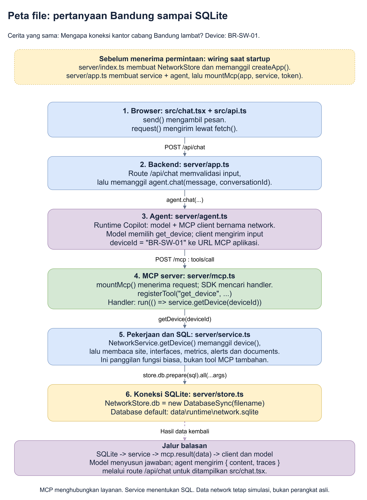
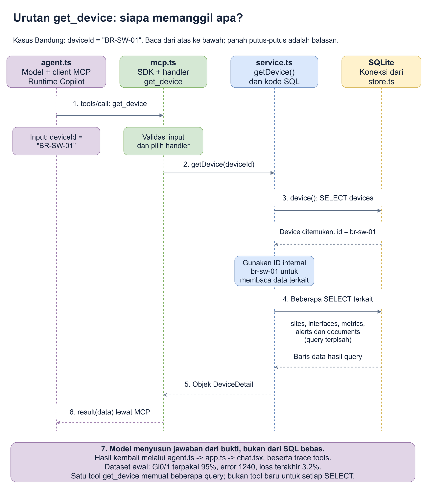

# 11. MCP dalam kode: dari nama tool sampai SQL SELECT

**Jawaban singkat:** model memilih tool, MCP client mengirim permintaan,
MCP server menjalankan handler, lalu service membaca database memakai SQL.
**SQL-nya sudah ditulis pengembang, bukan dikarang AI.**

Panduan ini mengikuti **kode yang benar-benar ada di NetOps Lab**.
Cerita kita tetap: **"Mengapa koneksi kantor cabang Bandung lambat?"**
Perangkat yang ditelusuri adalah **BR-SW-01**. Data network adalah simulasi.

Jika hanya ingin membuka tiga file utama:

1. [server/mcp.ts](../server/mcp.ts#L63): nama tool disambungkan ke fungsi.
2. [server/service.ts](../server/service.ts#L83): fungsi membaca data dan berisi SQL.
3. [server/store.ts](../server/store.ts#L16): koneksi SQLite dan pembuatan tabel.

## 1. Kenali perannya dahulu

Bayangkan semuanya sebagai **kantor operasi** yang melayani pencarian arsip.

| Istilah | Arti sederhana | Dalam kantor operasi |
|---|---|---|
| **Model / AI** | Memilih informasi yang perlu diminta, lalu menjelaskan hasil | Asisten yang menyusun jawaban dari bukti |
| **MCP** | Model Context Protocol: aturan komunikasi untuk meminta layanan dan menerima hasil | Aturan formulir dan balasan antarbagian |
| **MCP client** | Bagian program yang mengirim permintaan MCP; di sini disediakan runtime Copilot | Petugas pengantar formulir |
| **MCP server** | Program yang menawarkan layanan dan menerima pemanggilannya | Loket layanan |
| **Tool** | Satu layanan bernama dengan aturan input, misalnya `get_device` | Jenis formulir: "ambil detail perangkat" |
| **Handler** | Fungsi yang dijalankan ketika tool tersebut dipanggil | Petugas yang memproses formulir itu |
| **Service** | Kode pekerjaan aplikasi: membaca data, memeriksa aturan, mengolah hasil | Bagian pencari arsip |
| **SQLite dan SQL** | SQLite adalah database; SQL adalah bahasa untuk membaca atau mengubah tabelnya | Lemari arsip dan cara meminta isinya |

> **Yang sering tertukar:** `registerTool(...)` berarti **mendaftarkan**
> layanan, bukan langsung memanggilnya. Handler baru berjalan ketika ada
> permintaan pemanggilan tool.

## 2. Peta koneksi file

Panah utama di gambar mengikuti perjalanan permintaan. Hasilnya kembali
melalui lapisan yang sama.



Sumber editable: [peta-kode-mcp.drawio](diagrams/peta-kode-mcp.drawio).

| Urutan | Buka kode ini | Apa yang terjadi? |
|---|---|---|
| 1 | [send di src/chat.tsx](../src/chat.tsx#L134) | Mengambil pesan yang diketik dan memanggil helper `request("/api/chat", ...)` |
| 2 | [request di src/api.ts](../src/api.ts#L226) | Mengirim HTTP: permintaan dari browser ke backend |
| 3 | [route /api/chat di server/app.ts](../server/app.ts#L108) | Memeriksa input, lalu memanggil `agent.chat(...)` |
| 4 | [NetworkAgent di server/agent.ts](../server/agent.ts#L116) | Menyiapkan percakapan Copilot dan koneksi client MCP bernama `network`; model memilih tool |
| 5 | [mountMcp di server/mcp.ts](../server/mcp.ts#L155) | Menerima `POST /mcp`; SDK MCP mengarahkan pemanggilan ke handler yang terdaftar |
| 6 | [get_device di server/mcp.ts](../server/mcp.ts#L63) | Handler memanggil `service.getDevice(deviceId)` |
| 7 | [getDevice di server/service.ts](../server/service.ts#L83) | Membaca perangkat dan data terkait dengan beberapa query |
| 8 | [NetworkStore di server/store.ts](../server/store.ts#L16) | Menyediakan `store.db`, yaitu koneksi ke SQLite |

**Siapa menyambungkan semua bagian ini saat aplikasi menyala?**
[server/index.ts](../server/index.ts#L15) membuat `NetworkStore`, lalu memanggil
`createApp`. Di [server/app.ts](../server/app.ts#L24), `createApp` membuat
`NetworkService` dan `NetworkAgent`, kemudian memasang endpoint MCP memakai
`mountMcp(app, service, mcpToken)`.

Lokasi database default adalah `data\runtime\network.sqlite`, relatif terhadap
folder tempat aplikasi dijalankan. `DATABASE_PATH` bisa menggantinya.
Alamat MCP default adalah **http://127.0.0.1:4173/mcp**.

**Dua jalur yang berbeda:**

- **Chat AI:** browser -> `/api/chat` -> agent -> `/mcp` -> service -> database.
- **Dashboard biasa:** browser -> `/api/devices`, misalnya -> service -> database.
  Jalur dashboard ini **tidak melewati MCP**.

Keduanya memakai service dan database yang sama. Dalam analogi kantor, petugas
layar dashboard dan loket MCP membaca lemari arsip yang sama.

## 3. Ikuti satu pemanggilan `get_device`

Gambar ini memperbesar bagian agent sampai database. Query terkait
dikelompokkan supaya terbaca; bukan satu perintah SQL besar.



Sumber editable: [urutan-get-device.drawio](diagrams/urutan-get-device.drawio).

### A. Agent mengetahui tools yang boleh dipakai

Di [newConversation](../server/agent.ts#L116), konfigurasi
`mcpServers.network` menunjuk ke URL MCP aplikasi. Daftar tool berasal dari
[MCP_TOOL_NAMES](../server/mcp.ts#L9), bukan nama file yang ditebak AI.

Potongan konfigurasi aktual:

```ts
availableTools: MCP_TOOL_NAMES.map((name) => `mcp:network-${name}`),
excludedTools: ["builtin:*", "custom:*"],
```

SDK adalah library yang menangani komunikasi protokol. SDK mengurus koneksi
dan penemuan daftar layanan melalui `tools/list`. Server menyediakan nama,
deskripsi dan **schema**, yaitu aturan kolom input setiap tool.
Header autentikasi diatur backend; pengguna tidak perlu menyalin token ke chat.

### B. Model memilih tool dan mengisi input

Untuk cerita Bandung, model dapat memilih `get_device` dengan
`deviceId = "BR-SW-01"`. Berikut contoh pesan MCP **setelah inisialisasi**:

```json
{
  "jsonrpc": "2.0",
  "id": 2,
  "method": "tools/call",
  "params": {
    "name": "get_device",
    "arguments": { "deviceId": "BR-SW-01" }
  }
}
```

**JSON** adalah format pasangan nama dan nilai yang dibaca program.
`name` memilih layanan; `arguments` mengisi formulirnya.
SDK mengirim pesan ini, bukan pengguna mengetik SQL.
Ini juga **bukan** bentuk body untuk endpoint chat `/api/chat`.

### C. Handler menghubungkan nama tool ke fungsi biasa

Kode aktual di [registrasi get_device](../server/mcp.ts#L63):

```ts
server.registerTool("get_device", {
  description: "Detail device: interface, metrics snapshot, alerts dan metadata dokumen terkait. Tidak melakukan koneksi device asli.",
  inputSchema: { deviceId: identifier }, annotations: read,
}, ({ deviceId }) => run(() => service.getDevice(deviceId)));
```

Cara membacanya:

1. `"get_device"` adalah nama layanan yang dilihat client.
2. `inputSchema` menentukan input yang diterima; `identifier` adalah aturan
   string untuk ID atau hostname.
3. `({ deviceId }) => ...` adalah handler: ambil nilai dari input.
4. `service.getDevice(deviceId)` menjalankan fungsi TypeScript biasa.
5. `run(...)` membungkus hasil atau mengembalikan error yang jelas.

**Jadi MCP server tidak menebak kode SQL.** Petugas loket meneruskan formulir
ke fungsi yang sudah ditentukan pengembang.

### D. Service mengumpulkan data terkait

Kode aktual di [NetworkService.getDevice](../server/service.ts#L83):

```ts
getDevice(identifier: string): DeviceDetail {
  const device = this.device(identifier);
  const site = this.listSites().find((item) => item.id === device.siteId);
  if (!site) throw new AppError(500, "DATA_INTEGRITY", "Site device tidak tersedia.");
  return {
    device, site,
    interfaces: this.rows(interfaceSchema, "SELECT * FROM interfaces WHERE deviceId = ? ORDER BY name", device.id),
    metrics: this.getMetrics(device.id),
    alerts: this.listAlerts({ deviceId: device.id }),
    documents: this.listDocuments({ deviceId: device.id }),
  };
}
```

`DeviceDetail` adalah bentuk hasil: perangkat, lokasi, port, metrics, alert,
dan metadata dokumen. Jadi **satu tool bisa menjalankan beberapa SELECT**.
`SELECT` berarti membaca baris dari tabel.

| Pemanggilan dalam fungsi | Hasil yang dibuat dan dipakai |
|---|---|
| `this.device(identifier)` | Menemukan perangkat dan ID internal `br-sw-01` untuk query berikutnya |
| `this.listSites()` | Membaca lokasi, lalu kode memilih site perangkat tersebut |
| `this.rows(...)` untuk interfaces | Membaca port milik `br-sw-01` |
| `this.getMetrics(device.id)` | Memeriksa device lagi, lalu membaca maksimal 24 sampel pengamatan |
| `this.listAlerts(...)` | Membaca alert perangkat yang belum resolved, artinya belum ditandai selesai |
| `this.listDocuments(...)` | Mengembalikan metadata dokumen terkait, tanpa isi lengkap |

> **Penting:** `getDevice()` memanggil `getMetrics()` sebagai **fungsi biasa**.
> Ini bukan pemanggilan tool MCP `get_device_metrics` kedua. Karena itu,
> query-query di dalamnya tidak muncul sebagai tool terpisah pada trace.

### E. Di sinilah SQL benar-benar dijalankan

[Fungsi device](../server/service.ts#L70) memakai SQL ini:

```sql
SELECT *
FROM devices
WHERE id = ? OR hostname = ? COLLATE NOCASE
```

`SELECT *` mengambil semua kolom. `WHERE` membatasi baris.
`COLLATE NOCASE` membuat pencocokan hostname tidak membedakan huruf besar/kecil.
Kedua `?` diisi `"BR-SW-01"`; hasil lookup memberi ID internal `"br-sw-01"`.

Tanda `?` adalah **parameter binding**: nilai dikirim terpisah dari perintah SQL,
bukan ditempel menjadi perintah baru. Ibarat menulis nama pada kolom formulir,
bukan mengubah aturan kerja petugas.

Eksekusinya ada di helper [rows](../server/service.ts#L40):

```ts
private rows<T>(schema: z.ZodType<T>, sql: string, ...args: SQLInputValue[]): T[] {
  return z.array(schema).parse(this.store.db.prepare(sql).all(...args));
}
```

- `prepare(sql)` menyiapkan perintah.
- `.all(...args)` mengisi parameter dan mengambil seluruh baris yang cocok.
- `schema.parse(...)` memeriksa bahwa bentuk hasil sesuai harapan.
- `this.store.db` berasal dari `new DatabaseSync(filename)` di
  [NetworkStore](../server/store.ts#L18).

Setelah ID ditemukan, query port dan metrics yang dipakai adalah:

```sql
SELECT * FROM interfaces WHERE deviceId = ? ORDER BY name
```

Parameter: `["br-sw-01"]`.

```sql
SELECT *
FROM (
  SELECT * FROM metrics
  WHERE deviceId = ?
  ORDER BY timestamp DESC
  LIMIT ?
)
ORDER BY timestamp
```

Parameter: `["br-sw-01", 24]`. Query dalam memilih 24 sampel terbaru.
Query luar menyusunnya dari lama ke baru.
**Timestamp** adalah penanda waktu pada setiap sampel.

Pada dataset awal, hasilnya mencakup port **Gi0/1 dengan utilisasi 95%**,
counter error **1240**, dan metrics terakhir dengan **packet loss 3.2%**.
Ini bukti dari snapshot simulasi, bukan hasil polling perangkat saat ini.

### F. Hasil SQL dikembalikan, lalu model menjelaskan

[result di server/mcp.ts](../server/mcp.ts#L16) membungkus hasil:

```ts
function result(data: unknown) {
  const envelope = { simulation: true, data };
  return { content: [{ type: "text" as const, text: JSON.stringify(envelope) }], structuredContent: envelope };
}
```

`content` membawa hasil sebagai teks JSON; `structuredContent` membawa objek
yang sama dalam bentuk terstruktur. **Ini data tool, belum jawaban AI.**

Runtime memberikan hasil tool kepada model. Model dapat meminta bukti tambahan,
lalu menyusun jawaban. [agent.chat](../server/agent.ts#L166) mengembalikan
`content` jawaban dan `traces` ke route chat, kemudian browser menampilkannya.

Jika perangkat tidak ditemukan, service melempar `DEVICE_NOT_FOUND`.
[run](../server/mcp.ts#L21) mencatat kegagalan dan mengembalikan `isError: true`,
bukan data sukses kosong. Dalam kantor operasi, petugas menyatakan arsip tidak
ada, bukan mengarang isinya.

## 4. Kalau tool mencari dokumen, SQL-nya apa?

Kita masih menyelidiki BR-SW-01. Angka saja belum cukup untuk menjelaskan
penyebab, jadi agent dapat mencari runbook, yaitu panduan pemeriksaan.

Pemanggilan ringkasnya:

```text
search_documents({ query: "congestion", deviceId: "br-sw-01" })
```

Di [searchDocuments](../server/service.ts#L215), kode membuat pencarian
**FTS5**, yaitu fitur pencarian kata pada judul, isi dan tags dokumen di SQLite.
Untuk input di atas, SQL yang terbentuk adalah:

```sql
SELECT d.*, bm25(documents_fts) AS score,
  snippet(documents_fts, 1, '', '', ' ... ', 35) AS excerpt
FROM documents_fts JOIN documents d ON d.rowid = documents_fts.rowid
WHERE documents_fts MATCH ? AND d.deviceId = ?
ORDER BY score
LIMIT 20
```

Parameter: `['"congestion"', 'br-sw-01']`.
Tanda kutip di dalam parameter pertama adalah bagian dari pencarian FTS.
`d` adalah nama singkat tabel documents; `MATCH` mencari kata.
`score` dipakai untuk mengurutkan relevansi; `excerpt` adalah cuplikan isi.

SQL mengambil `d.*`, tetapi service membuang kolom `content` dari hasil tool
search. Agent menerima metadata, cuplikan dan skor, bukan body lengkap.
Ini seperti mencari katalog arsip sebelum membuka mapnya.

Untuk membaca map yang dipilih, agent dapat melanjutkan:

```text
get_document({ documentId: "doc-branch-runbook" })
```

Kode aktual [getDocument](../server/service.ts#L192):

```ts
const row = this.store.db.prepare("SELECT * FROM documents WHERE id = ?").get(id);
```

Nilai `id` adalah `"doc-branch-runbook"`. `.get(...)` mengambil satu baris.
Hasil tool sekarang memuat isi lengkap dokumen.
**Tool dokumen juga memakai SQL**, karena teks dokumen disimpan di SQLite.
Saat tool ini dipanggil, kode tidak membuka ulang file seed asli.

## 5. Peta lengkap: 17 tool memanggil fungsi apa?

Klik nama tool untuk melihat registrasinya. Klik nama fungsi untuk melihat
implementasi dan SQL-nya. **Semua tool terdaftar tidak berarti semuanya
dipanggil pada setiap pertanyaan.** Pilihan dan urutannya dapat berbeda.

| Tool di MCP server | Fungsi di service | Pekerjaan utamanya |
|---|---|---|
| [network_overview](../server/mcp.ts#L49) | [overview()](../server/service.ts#L118) | SELECT perangkat, site, metadata, alert dan jumlah tabel; hitung status di kode |
| [list_sites](../server/mcp.ts#L53) | [listSites()](../server/service.ts#L44) | `SELECT * FROM sites ORDER BY code` |
| [list_devices](../server/mcp.ts#L56) | [listDevices(args)](../server/service.ts#L53) | SELECT devices dengan filter opsional |
| [get_device](../server/mcp.ts#L63) | [getDevice(deviceId)](../server/service.ts#L83) | Beberapa SELECT untuk detail perangkat dan data terkait |
| [get_device_metrics](../server/mcp.ts#L67) | [getMetrics(deviceId, limit)](../server/service.ts#L96) | Lookup perangkat, lalu SELECT metrics terbaru; maksimal 24 |
| [list_alerts](../server/mcp.ts#L71) | [listAlerts(args)](../server/service.ts#L103) | SELECT alerts JOIN devices; hanya alert yang belum resolved |
| [get_topology](../server/mcp.ts#L77) | [topology()](../server/service.ts#L139) | SELECT sites, devices, interfaces dan links |
| [get_device_neighbors](../server/mcp.ts#L81) | [neighbors(deviceId)](../server/service.ts#L147) | Membaca topology dan perangkat; menghitung tetangga di kode |
| [list_vlans](../server/mcp.ts#L85) | [listVlans(siteId)](../server/service.ts#L48) | SELECT vlans, bisa difilter site |
| [list_documents](../server/mcp.ts#L89) | [listDocuments(args)](../server/service.ts#L198) | SELECT documents, lalu keluarkan metadata tanpa content |
| [search_documents](../server/mcp.ts#L93) | [searchDocuments(query, filters)](../server/service.ts#L215) | SELECT index FTS5 JOIN documents; maksimal 20 hasil |
| [get_document](../server/mcp.ts#L97) | [getDocument(documentId)](../server/service.ts#L192) | SELECT satu documents berdasarkan ID, termasuk content |
| [preview_change](../server/mcp.ts#L101) | [previewChange(args)](../server/service.ts#L261) | Membaca kondisi dan memvalidasi rencana; tidak menulis target |
| [create_change_request](../server/mcp.ts#L105) | [createChange(args, "agent")](../server/service.ts#L343) | Validasi, INSERT request pending ke changes dan INSERT audit |
| [list_change_requests](../server/mcp.ts#L110) | [listChanges()](../server/service.ts#L364) | SELECT maksimal 100 ID request, lalu membaca detail setiap ID |
| [get_change_request](../server/mcp.ts#L114) | [getChange(changeId)](../server/service.ts#L357) | `SELECT * FROM changes WHERE id = ?` |
| [get_audit_log](../server/mcp.ts#L118) | [audit()](../server/service.ts#L452) | `SELECT * FROM audit ORDER BY id DESC LIMIT 200` |

**Tidak ada tool approval.** `create_change_request` hanya mencatat pengajuan.
Untuk melanjutkan perubahan, manusia memakai web:

```text
preview_change -> create_change_request -> status pending
manusia klik Setujui -> POST /api/changes/:id/decision
-> service.decideChange() -> apply() -> perubahan target + audit
```

Lihat [route keputusan](../server/app.ts#L101),
[decideChange](../server/service.ts#L369), dan [apply](../server/service.ts#L400)
untuk SQL INSERT/UPDATE/DELETE target. Perubahan dijalankan dalam transaksi:
satu rangkaian perubahan yang di-commit bersama, atau dibatalkan jika gagal.
Dalam kantor operasi, formulir pengajuan belum berarti arsip sudah diubah.

## 6. Cara mencocokkan layar dengan kode

Jika aplikasi belum menyala, ikuti [panduan operasional](07-operasional.md).

1. Buka **http://127.0.0.1:4173**, panel **Copilot**, lalu **Hubungkan Copilot**.
2. Kirim: **"Mengapa koneksi kantor cabang Bandung lambat?"**
3. Di jawaban, buka **tool trace - lihat bukti**, lalu buka salah satu tool.
4. Cocokkan **ARGUMENTS - RAW** dengan input handler, dan **RESULT - RAW**
   dengan hasil service. Label layar memakai pemisah titik di tengah.
5. Klik link tool pada tabel di atas untuk mengikuti kode sampai SQL.

Trace dicatat dari event `tool.execution_start` dan `tool.execution_complete`
di [agent.chat](../server/agent.ts#L180), lalu ditampilkan oleh
[TraceList](../src/chat.tsx#L45).
**Trace menampilkan pemanggilan tool, bukan daftar SQL atau seluruh fungsi
internalnya.** Gunakan peta kode untuk menyambungkan keduanya.

Untuk membuktikan client memanggil server MCP **tanpa model AI**, baca
[scripts/smoke-mcp.ts](../scripts/smoke-mcp.ts). Di sana ada kode seperti:

```ts
await client.callTool({ name: "get_device", arguments: { deviceId: "BR-SW-01" } })
```

Jalankan pengujian yang sudah tersedia:

```powershell
Set-Location 'C:\clients\Organization\demo\fundamental\network-mcp-demo'
npm run test:mcp
```

Pengujian memakai server lokal dan **database sementara** melalui
[harness](../scripts/harness.ts), bukan database demo utama. Pengujian
memeriksa daftar 17 tools, pembacaan data dan dokumen, serta alur approval.
Ibarat mengecek layanan dengan formulir sungguhan pada lemari arsip latihan.

**Intinya:** nama tool ada di MCP; hubungan tool ke fungsi ada di handler;
pekerjaan dan SQL ada di service; koneksi database ada di store.
Model menerima bukti lalu membuat penjelasan, bukan mendapat akses SQL bebas.

Lanjutan: [penjelasan tools untuk pemula](04-mcp.md) dan
[cara melihat tabel SQLite langsung](10-bukti-data-live.md).
