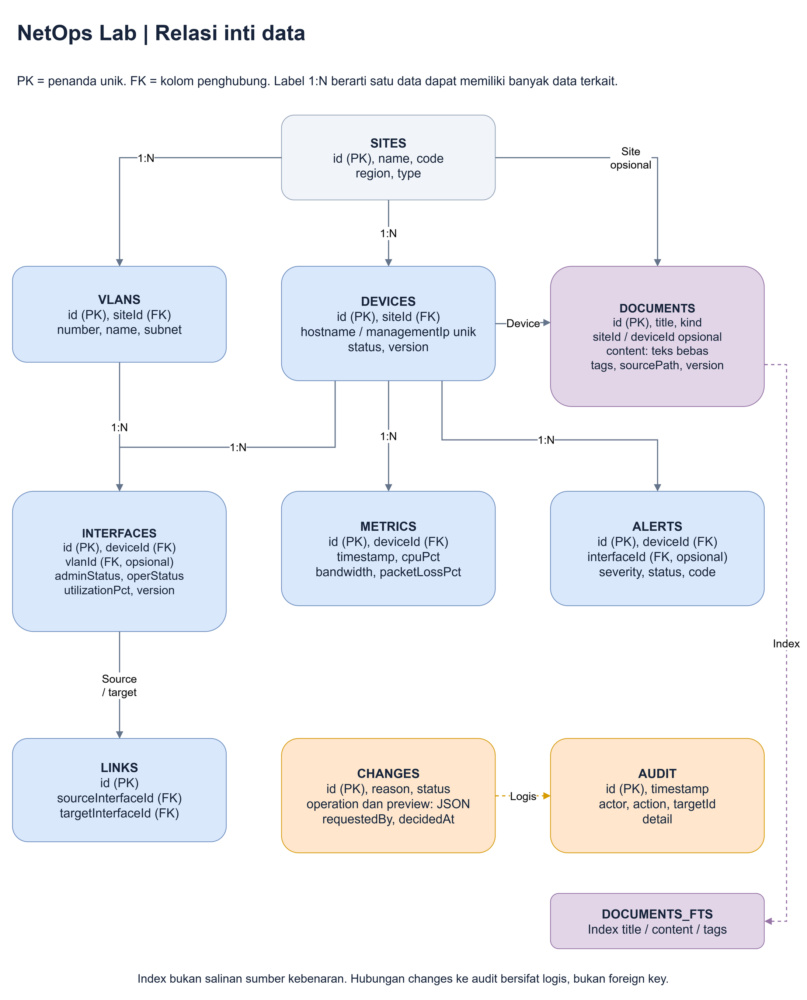

# Referensi lanjutan: model data dan ingestion

Bagian ini untuk pembaca yang ingin memeriksa kolom dan aturan penyimpanan.
Untuk penjelasan dari nol, mulai dari [Data seperti apa yang dibaca MCP?](../03-data-dan-ingestion.md).

## Isi dataset awal

| Entity | Jumlah | Keterangan |
|---|---:|---|
| Site | 3 | Jakarta HQ, Serpong DC, Bandung branch |
| Device | 25 | 10 HQ, 8 DC, 7 branch |
| Interface | 102 | Umumnya 4 port; HQ-RTR-01 dan BR-SW-01 memiliki 5 |
| Link | 24 | 22 link internal site dan 2 link antar-site |
| VLAN | 9 | VLAN 10, 20, 99 pada setiap site |
| Metric | 600 | 24 sampel per device, interval 5 menit |
| Alert | 3 | 2 warning, 1 critical |
| Document | 10 | 4 runbook, 2 incident, 2 config, 2 log |

Status device awal: **22 healthy, 2 warning, 1 critical, 0 offline**.
Snapshot akhir **2026-10-28T07:00:00Z = 28 Oktober 2026 14:00 WIB**.
Sampel pertama 05:05 UTC / 12:05 WIB.

## Diagram relasi



Sumber yang dapat diedit: [relasi-data.drawio](../diagrams/relasi-data.drawio).

Hubungan changes dan audit adalah **hubungan logis** melalui targetId, bukan
foreign key database. Audit juga mencatat ingestion/reset sehingga tidak semua
entry audit berhubungan dengan change request.

## Field penting

### Device

- `id`: identifier stabil, misalnya `br-sw-01`.
- `hostname`: nama tampil, misalnya `BR-SW-01`.
- `type`: `router`, `switch`, `firewall`, `access_point`.
- `managementIp`: IP fiktif private.
- `siteId`: lokasi perangkat.
- `status`: status dalam snapshot, bukan hasil polling hardware.
- `version`: mulai dari 1, bertambah setelah update.

### Interface

- `adminStatus`: status administratif yang bisa diajukan untuk diubah.
- `operStatus`: kondisi operasional dalam model simulasi.
- `vlanId`: ID VLAN, contohnya `br-vlan-20`, bukan angka string `"20"`.
- `utilizationPct`, `errors`: pengamatan snapshot.
- `version`: pemeriksaan konflik perubahan.

Admin down membuat operStatus down dan link yang terkait ikut down. Admin up
**tidak otomatis** memalsukan hasil observasi link pulih. Dataset tidak punya
poller yang menemukan operStatus terbaru.

### Document

- `kind`: `runbook`, `incident`, `config`, `log`.
- `content`: teks bebas; bagian unstructured.
- `title`, `tags`, `deviceId`, `siteId`: metadata structured.
- `sourcePath`: asal file seed. Dokumen baru dari UI mempunyai nilai null.
- `version`, `updatedAt`: membantu melihat perubahan dan menghindari overwrite.

Dokumen configuration adalah **snapshot teks historis**, bukan representasi
konfigurasi live yang otomatis disinkronkan dengan tabel interface.

### Change request

Menyimpan operasi terstruktur, alasan, preview before/after, status dan waktu.
Preview juga menjadi catatan perubahan konfigurasi model. Demo tidak mempunyai
tabel `config_versions` atau mekanisme rollback otomatis tersendiri.

## Daftar dokumen awal

| ID | Jenis | Dipakai untuk |
|---|---|---|
| `doc-branch-runbook` | runbook | Investigasi congestion / branch lambat |
| `doc-interface-runbook` | runbook | Admin up, oper down |
| `doc-cpu-runbook` | runbook | CPU firewall tinggi |
| `doc-change-policy` | runbook | Aturan preview dan approval |
| `doc-branch-incident` | incident | Catatan backup window dan hipotesis |
| `doc-dc-incident` | incident | Catatan port down |
| `doc-branch-config` | config | Snapshot BR-SW-01 |
| `doc-dc-config` | config | Snapshot DC-SW-02 |
| `doc-branch-log` | log | Bukti utilisasi dan packet loss branch |
| `doc-dc-log` | log | Link down di DC |

## Tahap ingestion

### 1. Generate sumber

```powershell
npm run data:generate
```

Generator membuat:

- `data\seed\network.json`: seluruh tabel network dan metadata dokumen.
- `data\seed\documents\*.md`: runbook dan incident.
- `data\seed\documents\*.txt`: configuration snapshot.
- `data\seed\documents\*.log`: log simulasi.

Tidak ada random metrics. Sumber yang sama selalu menghasilkan bundle yang sama.
Menjalankan generator menulis ulang file sumber dummy, **bukan** database runtime.

### 2. Baca file dan validasi

```powershell
npm run data:ingest
```

Importer:

1. Membaca manifest JSON.
2. Membaca isi file dokumen dari path pada manifest.
3. Menolak file dokumen di luar folder seed yang dipilih, termasuk path hasil
   resolusi symlink.
4. Memvalidasi tipe, ID, IP, ukuran konten dan bentuk data melalui Zod.
5. Menghitung SHA-256 bundle sebagai fingerprint.

### 3. Simpan dalam satu transaksi

Semua row dimasukkan ke SQLite dengan foreign key aktif. Jika salah satu referensi
gagal, **seluruh import di-rollback**, bukan meninggalkan sebagian dataset.

Trigger SQLite otomatis mengisi index FTS5 saat dokumen masuk.
Metadata menyimpan datasetVersion, snapshotAt dan fingerprint.
Audit mencatat ingestion.

### 4. Perilaku import ulang

- Fingerprint sama: tidak mengimpor ulang; perubahan runtime dipertahankan.
- Database kosong: import berjalan.
- Dataset berbeda tetapi database sudah terisi: ditolak, supaya tidak diam-diam
  menimpa perubahan.
- `--reset`: penggantian dataset secara eksplisit; seluruh state runtime lama
  dihapus dalam transaksi.

```powershell
# Hentikan aplikasi dulu agar percakapan agent tidak memakai konteks lama.
npm run data:ingest -- --reset
```

Untuk folder sumber yang berbeda:

```powershell
npm run data:ingest -- --directory 'C:\demo-data\netops-seed' --reset
```

Folder harus mempunyai manifest dan dokumen dengan format yang sama. Ini importer
dataset demo, bukan importer PDF, CSV, syslog stream atau backup vendor arbitrer.
Jika mengubah dataset secara besar, sesuaikan juga skenario, ID referensi dan test.

## Bagaimana search bekerja?

SQLite FTS5 mengindeks `title`, `content` dan `tags`. Query dipecah menjadi
kata-kata, di-escape sebagai term FTS, lalu digabungkan dengan **OR**.

Contoh `interface down` dapat menemukan dokumen yang berisi salah satu atau
keduanya. Hasil diurutkan dengan ranking BM25 dan dibatasi maksimum 20 dokumen.
Filter `kind`, `siteId` dan `deviceId` dapat mempersempit hasil.

Ini **lexical full-text search**:

- Tidak ada embedding.
- Tidak ada vector database.
- Tidak menjamin sinonim yang tidak tertulis akan ditemukan.
- Gunakan keyword seperti `congestion`, `lambat`, `interface`, `down`, `cpu`.

Agent bisa mencoba keyword lain bila hasil pertama tidak relevan.

## Persistence

Database default: `data\runtime\network.sqlite`, beserta file SQLite WAL/SHM
sementara jika sedang dibuka.

- Restart aplikasi tidak mengembalikan seed.
- Edit dokumen runtime tidak mengubah file sumber.
- Reset mengembalikan isi generator bawaan.
- Chat/conversation web bukan entity bisnis persisten aplikasi; sesi client web
  perlu dimulai kembali setelah restart/reset.
