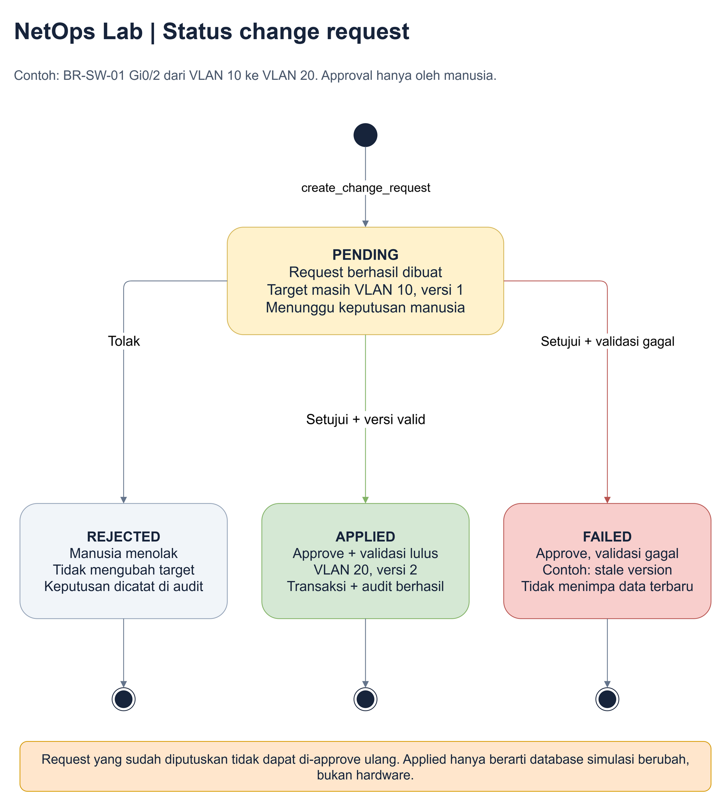

# Referensi lanjutan: tambah, baca, ubah dan hapus data

CRUD adalah singkatan dari empat pekerjaan: menambah, membaca, memperbarui dan
menghapus data. Bagian ini menyimpan contoh field yang lengkap.
Untuk latihan pertama di aplikasi, ikuti [Panduan klik demi klik](../05-panduan-aplikasi.md).

## Navigasi

Nama tab dapat berupa istilah pendek seperti Overview, Inventory, Topology,
Knowledge, Perubahan, Audit dan Panduan. Semuanya menggunakan dataset yang sama.

| Area | Yang dilakukan presenter |
|---|---|
| Overview / ringkasan | Melihat jumlah device, health dan tiga skenario masalah |
| Inventory | Filter site/status, cari hostname/IP, buka detail device |
| Detail device | Membaca metrics, interface, VLAN dan dokumen terkait |
| Topology | Melihat koneksi antar-device dan lokasi |
| Knowledge | Mencari dan membaca konten unstructured |
| Chat agent | Bertanya dalam bahasa alami dan melihat tool calls |
| Perubahan | Memeriksa before/after, menyetujui atau menolak request |
| Audit | Melihat jejak ingestion dan keputusan perubahan |
| Panduan | Penjelasan singkat penggunaan dan batas simulasi |

## Membaca data tanpa AI

Dashboard tidak bergantung pada model. Anda tetap bisa:

- Membuka device `BR-SW-01`.
- Memeriksa uplink `Gi0/1`, utilisasi 95% dan error 1240.
- Membaca metrics historis dan alert.
- Mencari kata `congestion` di knowledge.
- Membuka `doc-branch-log` dan `doc-branch-runbook`.
- Membuat perubahan dari form UI dan menjalankan approval.

Ini berguna jika koneksi internet atau login Copilot belum siap.

## Menggunakan agent

1. Pastikan sudah `copilot login`.
2. Klik Hubungkan Copilot.
3. Pilih pertanyaan contoh atau ketik pertanyaan sendiri.
4. Tunggu jawaban; investigasi bisa membutuhkan beberapa tool calls.
5. Buka trace untuk melihat nama tool, argumen dan hasil.
6. Cocokkan jawaban dengan detail device/dokumen.

Agent benar-benar memakai model. Waktu respons dan redaksi jawaban dapat
berbeda. Jika provider gagal, aplikasi menampilkan error, **bukan** jawaban dummy
seolah-olah model berhasil.

## Tambah device

Gunakan device yang belum ada agar demo CRUD aman:

```json
{
  "id": "demo-sw-01",
  "hostname": "DEMO-SW-01",
  "type": "switch",
  "vendor": "Simulator",
  "model": "Demo",
  "managementIp": "10.30.0.250",
  "siteId": "site-br",
  "status": "healthy",
  "description": "Perangkat tambahan untuk demo CRUD.",
  "firmware": "demo-1.0"
}
```

Alur:

1. Isi form dan alasan minimal 10 karakter.
2. Preview menampilkan before null dan after device baru.
3. Ajukan request. Inventory masih 25.
4. Buka tab Perubahan dan setujui. Inventory menjadi 26.
5. Device baru tidak otomatis mempunyai interface, metrics atau link.

ID, hostname dan management IP tidak boleh bentrok.

## Update device

Field yang dapat diubah pada demo: `description`, `managementIp`, `firmware`.
Gunakan versi terbaru dari detail device sebagai expectedVersion.

Contoh: edit deskripsi `DEMO-SW-01`. Sebelum approval deskripsi lama tetap;
setelah approval deskripsi baru tersimpan dan versi bertambah.

Tidak ada pembaruan firmware ke hardware; field firmware hanya metadata simulasi.

## Hapus device

Hapus `DEMO-SW-01` setelah demo update selesai:

1. Baca versi terakhir.
2. Preview delete.
3. Ajukan request.
4. Setujui dari tab Perubahan.
5. Inventory kembali 25.

Jika mencoba menghapus `BR-SW-01`, backend menolak karena masih ada interface,
metrics, alert dan dokumen terkait. Ini perilaku yang disengaja agar tidak
menghapus data berelasi diam-diam.

Demo tidak menyediakan operasi menghapus seluruh dependensi secara otomatis.

## Update VLAN atau admin status

Contoh aman: `BR-SW-01`, port `Gi0/2`, VLAN 10 -> 20.

- Gunakan VLAN dari site branch: `br-vlan-20`.
- VLAN head office seperti `hq-vlan-20` ditolak walaupun angkanya sama.
- Perubahan menghasilkan request pending.
- Approval memeriksa ulang versi, lalu memperbarui interface.
- Alert congestion pada uplink tetap ada karena port berbeda dan kondisi
  observability historis tidak otomatis diubah.

Untuk admin down pada uplink, preview memberi peringatan dampak downstream.
Admin down juga menandai link terkait down. Admin up tidak otomatis menyatakan
konektivitas pulih.

## CRUD dokumen unstructured

Contoh dokumen:

```json
{
  "id": "doc-demo-note",
  "title": "Catatan maintenance demo",
  "kind": "incident",
  "siteId": "site-br",
  "deviceId": "br-sw-01",
  "tags": ["maintenance", "demo"],
  "content": "Kode pencarian: demonstrasizebra. Pemeriksaan fisik belum dilakukan."
}
```

1. Ajukan tambah dokumen.
2. Sebelum approve, search `demonstrasizebra` belum menemukannya.
3. Setelah approve, hasil search menampilkan dokumen tersebut.
4. Edit body menjadi `demonstrasiharimau`, ajukan dan approve.
5. Search token lama tidak menemukan dokumen; token baru menemukannya.
6. Ajukan delete dan approve; dokumen hilang dari daftar dan index.

Field update yang didukung: title, content dan tags. Mengubah dokumen tidak
mengubah file seed di disk atau kondisi device.

## Status change request



Sumber yang dapat diedit: [status-perubahan.drawio](../diagrams/status-perubahan.drawio).

`applied` berarti transaksi database simulasi berhasil, **bukan** hardware telah
berubah. Request yang sudah diputuskan tidak dapat di-approve ulang.

## Menghadapi konflik versi

Misalnya dua request sama-sama membaca interface versi 1:

- Request A disetujui -> interface versi 2.
- Request B disetujui kemudian -> ditolak sebagai stale version dan ditandai failed.

Baca kondisi terbaru dan buat request baru. Jangan memaksa versi lama.

## Reset demo

Gunakan reset hanya setelah chat selesai. Konfirmasi eksplisit dibutuhkan.

Reset:

- Mengembalikan generator dataset awal.
- Menghapus perubahan, request dan audit lama.
- Menulis satu audit reset baru.
- Menghapus konteks percakapan agent yang dikelola aplikasi.
- Tidak mengubah file source code atau aplikasi lain.

Sebelum presentasi, reset lalu pastikan jumlah device 25 dan dokumen 10.
